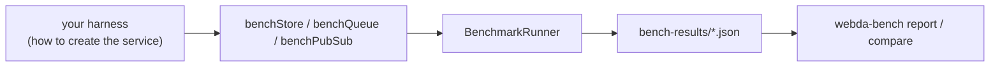

# Benchmarks

`@webda/bench` measures the Webda abstractions with one suite per abstraction, shared by every implementation:

| Suite      | Abstraction     | Measures                                                                                      |
| ---------- | --------------- | --------------------------------------------------------------------------------------------- |
| `store.*`  | `Store`         | CRUD, atomic operations, queries, pagination, bulk operations, concurrent updates             |
| `queue.*`  | `Queue`         | send, drain, `consume()` workers, end-to-end latency, redelivery of failed messages           |
| `pubsub.*` | `PubSubService` | publish, end-to-end latency and throughput, fan-out to several subscribers, payload sizes     |
| `blog.*`   | an application  | the blog-system sample: each request, a realistic mix, login, boot, REST vs GraphQL over HTTP |

Every built-in backend has a benchmark: Memory, File, PostgreSQL, MongoDB, AMQP, DynamoDB / SQS (LocalStack) and
Firestore / Pub/Sub (emulators). The [Benchmarks workflow](https://github.com/loopingz/webda.io/actions/workflows/bench.yml)
runs them every night and on pull requests labelled `benchmark`; the history is kept on the `benchmarks` branch.



## Benchmark your own service

The suites only need to know how to create your service, so a custom `Store`, `Queue` or `PubSubService` can be
measured exactly like the built-in ones. Benchmarks are vitest files named `*.bench.ts`:

```typescript title="src/mystore.bench.ts"
import { suite, test } from "@webda/test";
import { WebdaApplicationTest } from "@webda/core/lib/test/application.js";
import { benchStore, useServiceType } from "@webda/bench";

@suite
class MyStoreBench extends WebdaApplicationTest {
  getTestConfiguration() {
    return { parameters: { ignoreBeans: true }, services: {} };
  }

  @test
  async store() {
    await benchStore({
      backend: "MyStore",
      // The class registered by the application: it applies the parameters defaults
      createStore: (name, models) => this.addService(useServiceType("MyApp/MyStore"), { models }, name),
      // Optional: skip what your store does not support
      capabilities: { orderBy: false }
    });
  }
}
```

```typescript title="vitest.bench.config.ts"
import { defineConfig } from "vite";
import { benchVitestOptions } from "@webda/bench/lib/vitest.js";

export default defineConfig({ test: benchVitestOptions() });
```

```bash
pnpm exec vitest run --config vitest.bench.config.ts
WEBDA_BENCH_PROFILE=full pnpm exec vitest run --config vitest.bench.config.ts   # smoke | quick (default) | full
WEBDA_BENCH_FILTER="store.get,store.query.*" pnpm exec vitest run --config vitest.bench.config.ts
```

Each scenario prints a table and writes `bench-results/<suite>-<backend>.json`: throughput, latency percentiles,
CPU, memory, event loop delay, the Webda metrics of the service and correctness checks (lost or duplicated messages,
final value of concurrent increments...). A result with errors or a failed check is flagged `unstable`.

## Compare two runs

```bash
pnpm exec webda-bench report bench-results --markdown report.md
pnpm exec webda-bench compare baseline/bench-results bench-results --threshold 1.5 --fail
```

`compare` flags a scenario whose throughput is divided, or p99 latency multiplied, by more than the threshold.

## Reading the numbers

- **Closed-loop** scenarios (`concurrency=N`) give the throughput: N workers each wait for their operation.
- **Open-loop** scenarios (`ratePerSec=N`) give the latency under a steady load: operations start on schedule, so a
  slow backend cannot hide its queueing delay.
- Results flagged `emulated` come from LocalStack or the Google Cloud emulators: use them to spot regressions, not to
  compare with the real services.
