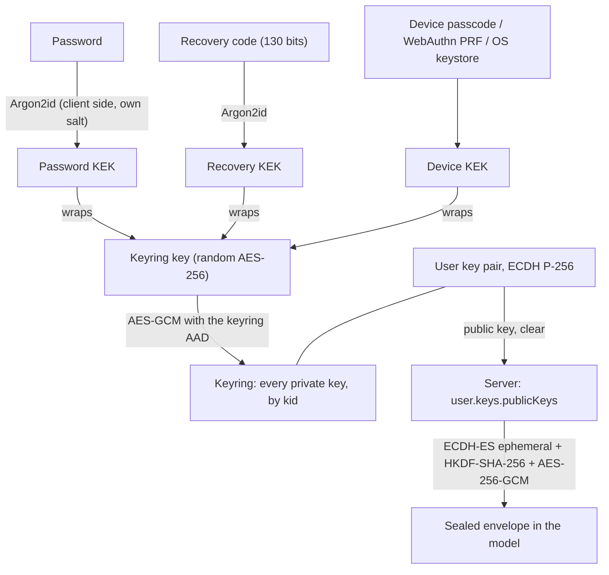

# Sealed fields

A **sealed field** is a model attribute encrypted end-to-end to a user: the server writes it with the user's _public_ key and can never read it again. Only the devices of the recipient, holding the matching private key, open it. A database dump, a backup or a curious operator sees ciphertext only.

```typescript
import { OwnerModel, SealedField } from "@webda/core";

export class Note extends OwnerModel {
  content: SealedField<{ title: string; body: string }>;

  constructor(data?: Settable<Note>) {
    super(data as any);
    Object.assign(this, data);
    (this as any).__hydrateBehaviors?.();
  }
}

// Server side: seal to the owner, then save. The plaintext is not kept on the instance.
await note.content.seal({ title, body });
await note.save();
```

`SealedField` is a [Behavior](./Behaviors.md) (`@WebdaBehavior Webda/Sealed`). Its `UserKeys` counterpart on the `User` model (`user.keys`, `@WebdaBehavior Webda/UserKeys`) stores the user public keys, the escrows and the encrypted keyring. The client side lives in the [`@webda/sealed-client`](https://github.com/loopingz/webda.io/tree/main/packages/sealed-client) package (`KeyVault`).

The `Note` model of the sample app and `packages/core/src/models/sealed.e2e.spec.ts` are a working end-to-end example.

## SealedField or EncryptedField

|                   | `EncryptedField`                               | `SealedField`                                       |
| ----------------- | ---------------------------------------------- | --------------------------------------------------- |
| Key               | server key (`CryptoService`)                   | user key pair, private key only on user devices     |
| Server can read   | yes (`await field.get()`)                      | **no**: there is no `get()`/`open()`                |
| Protects against  | database dump, backup                          | database dump, backup, operator, server compromise  |
| Server-side logic | can use the value (send an email, call an API) | cannot use the value                                |
| Lost password     | nothing lost                                   | data lost unless a device or a recovery code exists |
| Use for           | provider tokens, API keys the server must use  | private notes, documents, health data               |

`EncryptedField` is unchanged. Choose `SealedField` only when the server does not need the value.

## Key hierarchy



- The user owns an ECDH **P-256** key pair per `kid`; the public keys are stored in clear on the user.
- All the private keys form the **keyring**, encrypted by a random **keyring key**. The server stores the encrypted keyring.
- The keyring key (32 bytes) is wrapped by several KEKs: the **password escrow** and the **recovery code escrow** (stored on the server), and one **device blob** per device (stored on the device only, never sent).
- A KEK derived from a password or a code uses **Argon2id** (`m=65536 KiB, t=3, p=1`, 16-byte salt; PBKDF2-SHA-256 with 600 000 iterations as a fallback), the parameters travel in the blob. A platform KEK (WebAuthn PRF, OS keystore) wraps with AES-KW.
- The password KEK is derived **on the client with its own salt**, it has nothing to do with the server login hash: a server able to verify the password cannot derive the KEK.

## Flows

**Enrollment (first device).** `vault.enroll({ password, device, deviceName, recovery })` generates the key pair and keyring, creates the escrows and calls `User.Keys.Setup`, keeps the keyring key wrapped by the device KEK, pins the public key and registers the device. The recovery code is returned once: show it to the user.

**Seal (server).** `note.content.seal(value)` resolves the recipient public key, generates an ephemeral key, derives a content key with ECDH + HKDF and encrypts with AES-256-GCM. The stored envelope is `{ v: 1, kid, epk, iv, ct }`. The recipient is `seal(value, { user })`, else `model.getSealedRecipient(field)` (the owner of an `OwnerModel`), else the model owner. A recipient without a key fails with `SealedKeyMissingError` (412); a malformed key or envelope with `SealedFormatError` (400).

**Seal (client).** A client can seal the value itself and store the envelope, so the plaintext never reaches the server at all: `const envelope = await vault.seal(value, { modelType, uuid, field })` then `PUT <model>/{uuid}/<field>.set` with `{ "envelope": envelope }` (operation `<Model>.<Field>.Set`, for example `Note.Content.Set`). It is authorised like any behavior action by the model `canAct("<field>.set")` (the owner of an `OwnerModel`). The server checks the envelope shape (`v: 1`, a 12-byte `iv`, a ciphertext of at least 16 bytes, an `epk` P-256 public JWK) and that `kid` is the active key of the recipient (resolved as for `seal()`), otherwise it answers 400; then it saves this field only. The server cannot check that the value opens: a client sealing with a wrong AAD only hurts itself.

**Open (client).** `vault.open(envelope, { modelType, uuid, field })` finds the private key of `envelope.kid` in the unlocked keyring and decrypts.

**Add a device.** The new device calls `vault.unlockWithEscrow({ password })` (or `{ recoveryCode }`): it fetches the escrow and the encrypted keyring (`User.Keys.GetEscrow`), unwraps the keyring key locally, verifies the keyring against the served public keys and the pinned fingerprint, wraps the keyring key with its own device KEK and registers itself (`User.Keys.RegisterDevice`).

**Change the password.** `vault.changePassword(newPassword)` re-wraps the 32-byte keyring key with the new password KEK and replaces the escrow (`User.Keys.SetEscrow`). Existing devices keep working, nothing is re-encrypted. The password escrow must follow the login password: change both together, otherwise the next device has to be added with the old password.

**Rotate.** `vault.rotate()` adds a new active key pair and re-encrypts the keyring for it; the old key is marked `retiredAt` and stays in the keyring, so values sealed to it stay readable. New seals use the active `kid`. Values are **not** re-sealed automatically: a client may open and re-seal them. `vault.rotate({ newKeyringKey: ... })` also replaces the keyring key and rebuilds the escrows, the answer to a lost device.

## Associated data (AAD) for clients

A client that does not use `@webda/sealed-client` must authenticate the envelope with these exact AADs, otherwise decryption fails:

- Field envelope: `modelType + "|" + uuid + "|" + fieldName + "|" + kid`, where
  - `modelType` is the model identifier (for example `"WebdaDemo/Note"`),
  - `uuid` is the primary key (a composite key is joined with the model separator, `_` by default),
  - `fieldName` is the attribute name (`"content"`),
  - `kid` is the `kid` of the envelope.
- Keyring: `"webda-keyring|" + userId + "|" + kid + "|" + fingerprint(publicJwk)`, `fingerprint` being the base64url (no padding) SHA-256 of the raw uncompressed P-256 point.
- Escrow: `"webda-escrow|" + userId + "|" + kind` (`password` or `recovery`).

All encodings are base64url without padding and every envelope or blob carries `v: 1`. The binding to the record, attribute and recipient key means a copy moved to another record, another field or relabelled with another `kid` is refused.

## Recovery code or password escrow

- The **password escrow** lets the user add a device with the password they already know. Its strength is the strength of the password: the escrow is an offline brute-force target (see below).
- The **recovery code** is 26 Crockford base32 characters (130 random bits) in groups of 5, shown once at enrollment (skippable) and re-created while unlocked with `vault.setRecoveryCode()`. It is as strong as a key: a good fit to print and keep, and the only way back when the password is lost and no device is left.
- Either escrow adds a device. Without any escrow nor any device, the data is **unrecoverable**: that is the price of end-to-end encryption, make it explicit in your UI. The server refuses to remove the last escrow while no device is registered.

## Fresh authentication

Every key management operation (`User.Keys.GetEscrow`, `Setup`, `SetEscrow`, `RemoveEscrow`, `Rotate`, `RegisterDevice`, `RevokeDevice`) requires a **recent authentication**: the session `authAt` younger than `reauthMaxAge` seconds (default 300), and `session.mfa === "verified"` when the user has MFA enabled. Otherwise the call fails with 401. A stolen idle session therefore cannot register an attacker key, nor fetch the escrow. Only the user themselves can call them (`User.canAct`).

`GetEscrow` is also **throttled** (5 fetches per 15 minutes by default, the counter decays and is not reset by a successful call: the unwrap happens on the client, so every fetch counts as a guess) and **audited** (`AuditService`, operation `User.Keys.GetEscrow`, with the success flag).

## Threat model and limits

- **Protected:** database dumps, backups, a curious operator reading stored data, a server that is read but not modified.
- **Not protected: a malicious server shipping a modified web client.** The usual web E2EE limit: the code that handles the keys comes from the server. Native apps and pinned or audited clients reduce the risk.
- **Public key substitution (TOFU).** A compromised server could serve its own public key to the sealing code or to a new device. The client therefore **pins** the fingerprint of the active public key on first use (trust on first use) and refuses a different one unless the change comes from a rotation done or verified by this device (`KeyringPinError`). Show the fingerprint to the user and compare it out of band for stronger guarantees. Signing a new key with the previous one is a follow-up.
- **Escrow brute force.** A database dump gives the attacker the password escrow to attack offline: it is protected by Argon2id and by the quality of the password (apply a password policy). The recovery code has 130 bits and cannot be brute forced. The online path is throttled and needs fresh authentication.
- **No plaintext on the server.** `seal()` never keeps the value on the instance; the server never sees the private key, the keyring key, the password KEK or the recovery code. Do not log request bodies of key operations or the values you seal.
- **No query nor index.** The stored value is an opaque envelope: it cannot be filtered or indexed with `@webda/ql`. The content mapper marks the property `"x-webda-sealed": true` in the model schema so tools and forms can tell.
- **Revoked devices.** `User.Keys.RevokeDevice` removes the device from the server list and `vault.unlock()` on a revoked device deletes its local blob. It does **not** cancel what the device already knows: a device that kept its blob can still open the keyring with an escrow. To really lock a lost device out, call `vault.rotate({ newKeyringKey })`, which changes the keyring key and rebuilds the escrows; values sealed to older keys stay readable by the devices you keep, and are still exposed to whoever copied the old private key.
- **Password reset without a device.** If the user forgot the password and has no unlocked device nor recovery code, the old values stay unreadable; a new key pair makes new values readable only.
- **Offline and server-side processing.** The server cannot search, validate, index or transform a sealed value. Offline caches must store the envelope and decrypt on read.
