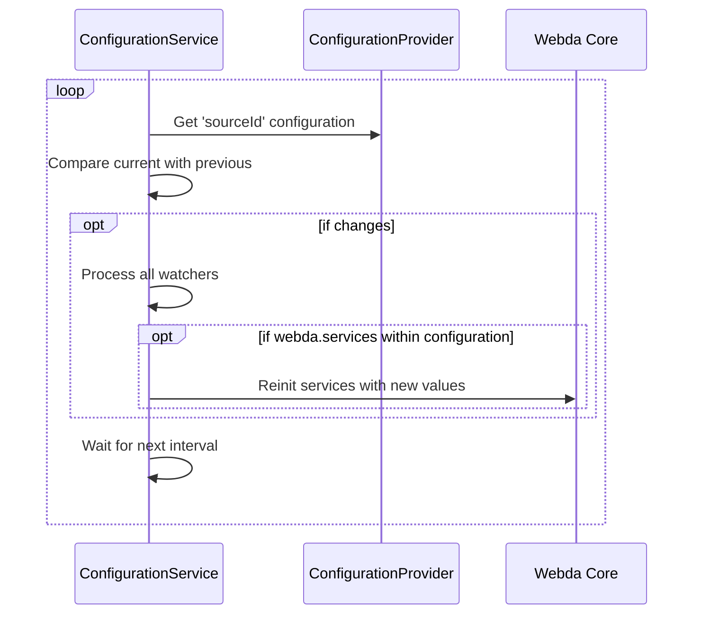

# Configuration Service

The Configuration Service allows you to get new configuration dynamically either by watching the configuration store or by checking at regular interval.

It will trigger only when the object changes.

```js title="local.config.json"
{
	"parameters": {
		"param2": "test"
	},
	"services": {
		"MyService": {
			"param1": "dynamic"
		}
	}
}
```

The configuration shared parameters is also available.

A service cannot be changed into another type of service for security purpose.
Creating dynamic route through the ConfigurationService is not recommended, it will be probably be block in the near future.

This is the general process if the ConfigurationProvider cannot trigger



This is the general process if the ConfigurationProvider can trigger, it will be on demand

## Existing Configuration Provider

- Every \{@link Store} as it is designed in the parent class
- \{@link FileConfiguration} to simply use a file as configuration
- \{@link KubernetesConfiguration} to simply use Kubernetes Secrets or ConfigMap

## Encrypted values

The configuration returned by the sources can contain encrypted values (`crypt:<encrypter>:<data>`): they are
decrypted before being applied, like in `webda.config.jsonc`. See [Configuration Secrets](../../Security/ConfigurationSecrets.md).
