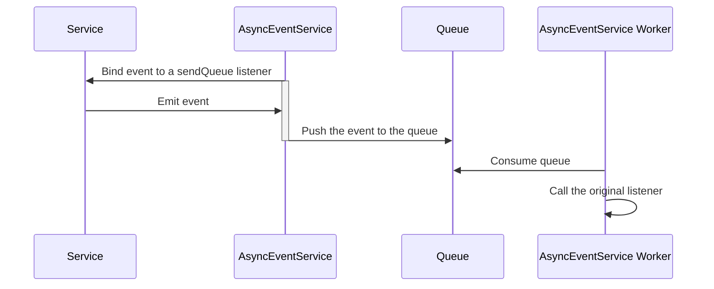

# Events

The framework use the EventEmitter for events.

`emit()` returns a Promise resolved once all the promises returned by listeners are resolved: await it to wait for the listeners, or ignore it

We also have a mechanism to listen asynchronously to events (`AsyncEvents` service of `@webda/async`). They will then be posted to a Queue for them
to be consumed through its `worker()`

### Webda.Init

### Webda.Init.Services

### Webda.Create.Services

### Webda.NewContext

### Webda.Request

### Models events

Model persistence events are the typed Repository events (`Created`, `Updated`, `Patched`, `Deleted`, `PartialUpdated`...), see [Repositories](../Stores/Repositories.md#events). The aggregate `Store.*` events are internal.
