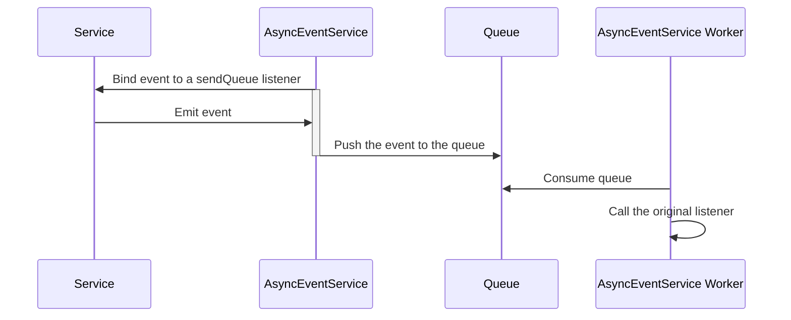

# Events

The framework use the EventEmitter for events.

`Service.emit()` returns a Promise resolved once all the promises returned by listeners are resolved: await it to wait for the listeners, or ignore it. (`emitCoreEvent()` is fire-and-forget and returns `void`.)

We also have a mechanism to listen asynchronously to events (`AsyncEvents` service of `@webda/async`). They will then be posted to a Queue for them
to be consumed through its `worker()`

### `Webda.Init.Services`

Emitted by `Core.init()` with `this.services` once all services have been initialized. (Note: `Webda.Init` and `Webda.Create.Services` exist in `CoreEvents` types for legacy reasons but are not emitted by `Core`.)

### `Webda.NewContext`

Emitted when `HttpServer` creates a new request context (`{ context }`).

### `Webda.Request`

Emitted before a request handler runs (`{ context }`).

### `Webda.Result`

Emitted after a request handler finishes (`{ context }`).

### `Webda.404`

Emitted by `Router` when no route matches (`{ context }`).

### Models events

Model persistence events are the typed Repository events (`Created`, `Updated`, `Patched`, `Deleted`, `PartialUpdated`...), see [Repositories](../Stores/Repositories.md#events). The aggregate `Store.*` events are internal.
