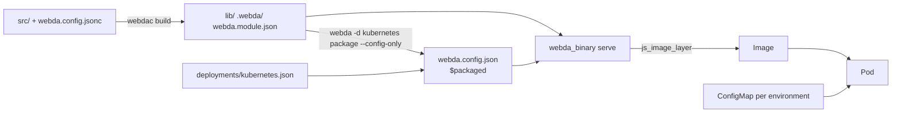

# Webda with Bazel

A Webda application builds with [Bazel](https://bazel.build) and aspect [`rules_js`](https://github.com/aspect-build/rules_js):
`webdac` compiles it in a Bazel action, the deployed configuration is generated by another action, and the image is
built from the Bazel `node_modules` with `js_image_layer`. The image runs `webda serve` without `-d`: no deployment
files, no modules scan at startup, and the same image runs in every environment, the environment coming only from a
ConfigMap.



The examples use an application in `apps/api`, with `@webda/core` and `@webda/compiler` in its `package.json`.

## Build

`webdac build` compiles `src/` to `lib/` and generates `.webda/` and `webda.module.json`:

```python title="apps/api/BUILD.bazel"
load("@aspect_rules_js//js:defs.bzl", "js_image_layer")
load("@npm//:defs.bzl", "npm_link_all_packages")
load("@npm//apps/api:@webda/compiler/package_json.bzl", webdac_bin = "bin")
load("@npm//apps/api:@webda/core/package_json.bzl", webda_bin = "bin")

npm_link_all_packages(name = "node_modules")

webdac_bin.webdac(
    name = "build",
    srcs = glob(["src/**/*.ts"]) + [
        ":node_modules",
        "package.json",
        "tsconfig.json",
        "webda.config.jsonc",
    ],
    args = ["build"],
    chdir = package_name(),
    outs = ["webda.module.json"],
    out_dirs = [
        ".webda",
        "lib",
    ],
)
```

`.webda/` is a declared output directory of this action: no other rule can add a file to it, like the
`.webda/packaged.json` marker of `webda package`.

## Deployed configuration

`webda -d <deployment> package --config-only` writes the configuration with the deployment applied, the modules
cached and the inline `$packaged` marker (see [Package a deployment](./Deployments.md#package-a-deployment)). Generate it
with a Bazel action, as the `webda.config.json` of the application:

```python title="apps/api/BUILD.bazel"
webda_bin.webda(
    name = "config",
    srcs = [
        ":build",
        ":node_modules",
        "deployments/kubernetes.json",
        "package.json",
        "webda.config.jsonc",
    ],
    args = [
        "-d",
        "kubernetes",
        "package",
        "--config-only",
        "-o",
        "webda.config.json",
    ],
    chdir = package_name(),
    outs = ["webda.config.json"],
)
```

The imports of the file are relative to the application folder and point to the `node_modules` it was generated in.
They only hold for this layout: the rules_js one, kept by the runfiles of the Bazel targets. Never generate the
configuration on your machine (pnpm `node_modules/.pnpm` layout) to commit it: always produce it with a Bazel action.

The action also bakes the git information in the configuration: the application reads it from the configuration at
runtime, the image needs no `.git`.

## Binary

The `serve` binary ships the generated `webda.config.json`, never `webda.config.jsonc` nor `deployments/`:

```python title="apps/api/BUILD.bazel"
webda_bin.webda_binary(
    name = "serve",
    args = ["serve"],
    chdir = package_name(),
    data = [
        ":build",
        ":config",
        ":node_modules",
        "package.json",
    ],
)
```

`bazel run //apps/api:serve` starts the application as packaged:

```
INFO Loading the packaged configuration .../apps/api/webda.config.json ($packaged)
```

## Image

`js_image_layer` turns the binary runfiles into image layers, with the Bazel `node_modules`: there is no need for the
full `webda package`, which copies `node_modules`.

```python title="apps/api/BUILD.bazel"
load("@rules_oci//oci:defs.bzl", "oci_image")

js_image_layer(
    name = "layers",
    binary = ":serve",
    root = "/",
)

oci_image(
    name = "image",
    base = "@node",
    entrypoint = [
        "/usr/local/bin/node",
        "node_modules/@webda/core/lib/bin/launcher.js",
        "serve",
    ],
    tars = [":layers"],
    workdir = "/apps/api/serve.runfiles/_main/apps/api",
)
```

The entrypoint has no `-d`: the deployment is already applied in `webda.config.json`.

## Per-environment configuration

The image is the same for every environment. The deployment used to generate the configuration (`kubernetes` here)
only selects a configuration source: [`KubernetesConfigurationService`](./Kubernetes/ConfigMap.md) on a ConfigMap,
which each environment provides.

```jsonc title="apps/api/deployments/kubernetes.json"
{
  "services": {
    "Configuration": {
      "type": "Webda/KubernetesConfigurationService",
      "source": "/etc/webda/config"
    }
  }
}
```

Each environment has its own ConfigMap file, its secrets encrypted with the
[`pki` encrypter](../Security/ConfigurationSecrets.md#pki-encrypter): the public keys are committed in
`.webda/keys`, anyone can encrypt a value, only the pods decrypt it with the private keys Secret mounted on
`/etc/webda/pki`.

```bash
webda -d kubernetes config encrypt -f k8s/beta/webda.jsonc
webda -d kubernetes config encrypt -f k8s/production/webda.jsonc
kubectl -n beta create configmap webda-config --from-file=webda.jsonc=k8s/beta/webda.jsonc
```

Check that no secret is committed in clear text, in a pre-commit hook and in CI:

```bash
webda config encrypt --check
for f in k8s/*/webda.jsonc; do webda -d kubernetes config encrypt --check -f "$f"; done
```

See [Configuration Secrets](../Security/ConfigurationSecrets.md) for the keys setup and their rotation.

## Pitfalls

- **One `webda.config` file in the binary.** The configuration file is the first of `webda.config.yaml`, `.yml`,
  `.jsonc` and `.json`. If `webda.config.jsonc` reaches the runfiles, it takes precedence over the generated
  `webda.config.json`: the application loads unpacked (modules scan, no baked git information) and logs a warning:

  ```
  WARN .../webda.config.json is packaged ($packaged) but .../webda.config.jsonc takes precedence: loading the application unpacked
  ```

- **One `webda.*` file per configuration source folder.** `KubernetesConfigurationService` reads a single
  `webda.json`, `webda.jsonc`, `webda.yaml` or `webda.yml` from the mounted folder: keep one file per ConfigMap.
- **`.webda/` is a Bazel output directory** of the `webdac` action, so the `.webda/packaged.json` marker cannot be
  added to it: the inline `$packaged` marker of `--config-only` replaces it.
- **Do not overwrite the source configuration.** `--config-only -o webda.config.json` refuses to replace the
  configuration file the application is loaded from (unless `--force`): in the source tree, a packaged
  `webda.config.json` would switch the application to packaged mode, with stale imports.
