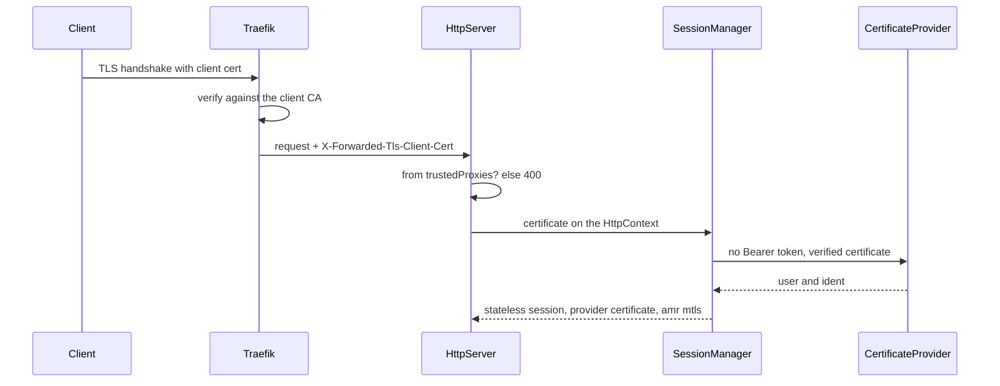

# mTLS with Traefik and cert-manager

This page sets up [client certificate authentication](../../Security/ClientCertificate.md) on Kubernetes:

- [cert-manager](https://cert-manager.io) issues the client CA and the client certificates (and the server certificate).
- [Traefik](https://traefik.io) terminates mTLS, verifies the client certificate and forwards it to Webda.
- Webda trusts the forwarded certificate only from Traefik (`trustedProxies`) and maps it to a user with
  `CertificateProvider`.



## cert-manager

A self-signed root becomes the CA issuing client certificates:

```yaml
apiVersion: cert-manager.io/v1
kind: Issuer
metadata: { name: selfsigned }
spec: { selfSigned: {} }
---
apiVersion: cert-manager.io/v1
kind: Certificate
metadata: { name: client-ca }
spec:
  isCA: true
  commonName: webda-client-ca
  secretName: client-ca
  issuerRef: { name: selfsigned, kind: Issuer }
---
apiVersion: cert-manager.io/v1
kind: Issuer
metadata: { name: client-ca }
spec: { ca: { secretName: client-ca } }
---
# One client certificate; cert-manager renews it before expiry
apiVersion: cert-manager.io/v1
kind: Certificate
metadata: { name: client-alice }
spec:
  commonName: alice
  emailAddresses: [alice@example.com]
  usages: [client auth, digital signature, key encipherment]
  secretName: client-alice
  issuerRef: { name: client-ca, kind: Issuer }
```

The `client-alice` secret holds `tls.crt` and `tls.key` for the client:

```bash
kubectl get secret client-alice -o jsonpath='{.data.tls\.crt}' | base64 -d > alice.crt
kubectl get secret client-alice -o jsonpath='{.data.tls\.key}' | base64 -d > alice.key
curl --cert alice.crt --key alice.key https://api.example.com/auth/me
```

## Proxy mode: Traefik terminates mTLS

```yaml
apiVersion: traefik.io/v1alpha1
kind: TLSOption
metadata: { name: mtls }
spec:
  clientAuth:
    secretNames: [client-ca]
    clientAuthType: RequireAndVerifyClientCert # or VerifyClientCertIfGiven
---
apiVersion: traefik.io/v1alpha1
kind: Middleware
metadata: { name: pass-client-cert }
spec:
  passTLSClientCert:
    pem: true
---
apiVersion: traefik.io/v1alpha1
kind: IngressRoute
metadata: { name: webda }
spec:
  entryPoints: [websecure]
  routes:
    - match: Host(`api.example.com`)
      kind: Rule
      middlewares: [{ name: pass-client-cert }]
      services: [{ name: webda, port: 18080 }]
  tls:
    secretName: api-example-com # cert-manager Certificate (ACME)
    options: { name: mtls }
```

Use `RequireAndVerifyClientCert` or `VerifyClientCertIfGiven` only: Webda considers the forwarded certificate verified,
`RequestClientCert` and `RequireAnyClientCert` would forward unverified certificates.

Webda configuration:

```json
{
  "services": {
    "HttpServer": { "trustedProxies": "10.0.0.0/8", "clientCertHeader": "x-forwarded-tls-client-cert" },
    "Authentication": { "type": "Webda/Authentication" },
    "CertificateProvider": { "type": "Webda/CertificateProvider", "identityField": "san.email", "autoRegister": false }
  }
}
```

:::warning

`trustedProxies` is the application-level guard: a `NetworkPolicy` must ensure only Traefik reaches the Webda pods,
otherwise any pod in `10.0.0.0/8` can forge `X-Forwarded-Tls-Client-Cert`.

:::

```yaml
apiVersion: networking.k8s.io/v1
kind: NetworkPolicy
metadata: { name: webda-from-traefik }
spec:
  podSelector: { matchLabels: { app: webda } }
  policyTypes: [Ingress]
  ingress:
    - from:
        - namespaceSelector: { matchLabels: { kubernetes.io/metadata.name: traefik } }
          podSelector: { matchLabels: { app.kubernetes.io/name: traefik } }
      ports: [{ port: 18080 }]
```

## Native mode: Webda terminates mTLS

Mount the server certificate and the client CA, and let Traefik pass the TLS connection through. Traefik then routes on
SNI only, it cannot route on paths nor add headers.

```json
{
  "services": {
    "HttpServer": {
      "key": "/certs/server/tls.key",
      "cert": "/certs/server/tls.crt",
      "clientCa": "/certs/client-ca/ca.crt",
      "clientAuth": "optional"
    }
  }
}
```

```yaml
# Deployment excerpt
volumes:
  - name: server-cert
    secret: { secretName: api-example-com }
  - name: client-ca
    secret: { secretName: client-ca, items: [{ key: ca.crt, path: ca.crt }] }
containers:
  - name: webda
    volumeMounts:
      - { name: server-cert, mountPath: /certs/server, readOnly: true }
      - { name: client-ca, mountPath: /certs/client-ca, readOnly: true }
---
apiVersion: traefik.io/v1alpha1
kind: IngressRouteTCP
metadata: { name: webda }
spec:
  entryPoints: [websecure]
  routes:
    - match: HostSNI(`api.example.com`)
      services: [{ name: webda, port: 18080 }]
  tls:
    passthrough: true
```

The certificates are read when the server starts: restart the pods when cert-manager renews the server certificate or
the client CA.

## Revocation

CRL/OCSP are not checked: issue short-lived client certificates (`duration`/`renewBefore` on the cert-manager
`Certificate`) and unlink a compromised certificate with `Auth.Unlink`.
