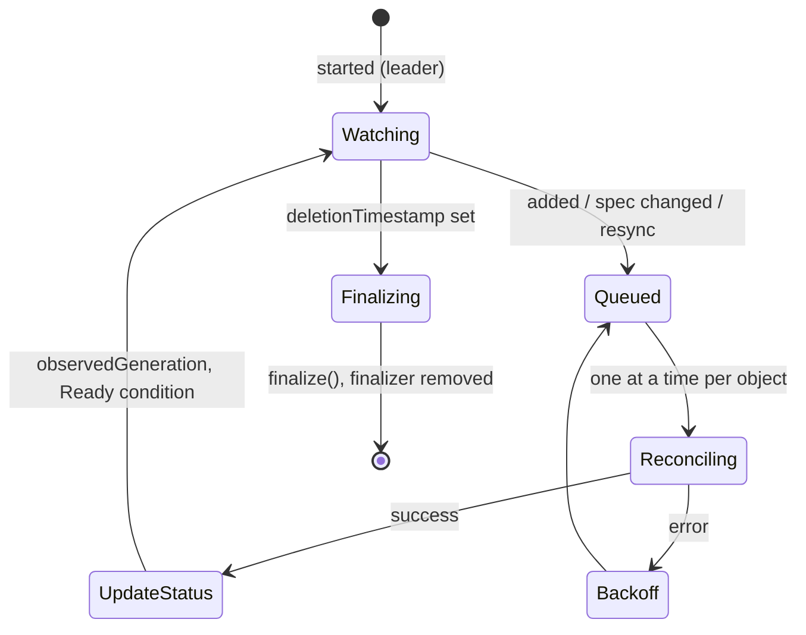

# Kubernetes Operator

`KubernetesOperator` reconciles models stored in a [Kubernetes store](./KubernetesStore.md), like a Kubernetes
controller: when an object's spec changes, it calls its `reconcile()` method and reports the result in its status.



## Model

```typescript
import { UuidModel } from "@webda/models";
import type { Reconcilable } from "@webda/kubernetes";

export class Tenant extends UuidModel implements Reconcilable {
  name!: string;
  ready?: boolean;

  async reconcile() {
    // e.g. provision a database, a namespace...
    await this.patch({ ready: true });
    // optional: reconcile again later
    return { requeueAfter: 60_000 };
  }

  async finalize() {
    // clean up before the object is deleted (needs the finalizer parameter)
  }
}
```

The CustomResourceDefinition of a model with a `reconcile` method gets a status subresource holding
`observedGeneration` and `conditions`.

## Configuration

```json title="webda.config.json"
{
  "services": {
    "tenantStore": {
      "type": "Webda/KubernetesStore",
      "group": "myapp.example.com",
      "models": ["MyApp/Tenant"],
      "statusFields": { "MyApp/Tenant": ["ready"] }
    },
    "tenantOperator": {
      "type": "Webda/KubernetesOperator",
      "models": ["MyApp/Tenant"],
      "finalizer": "myapp.example.com/finalizer"
    }
  }
}
```

Run it with `webda kubernetes operator`, or set `autoStart: true` to start it with the application.

| Parameter                           | Default                         | Description                                                       |
| ----------------------------------- | ------------------------------- | ----------------------------------------------------------------- |
| `models`                            | required                        | Models to reconcile, stored in a `KubernetesStore`                |
| `concurrency`                       | `1`                             | Objects of a model reconciled at the same time                    |
| `resyncPeriod`                      | `300000`                        | Milliseconds between two reconciliations of every object          |
| `maxBackoff`                        | `300000`                        | Maximum milliseconds before retrying a failed object              |
| `finalizer`                         | none                            | Finalizer added to the objects: `finalize()` runs before deletion |
| `leaderElection`                    | `true`                          | Only the replica holding the Lease reconciles                     |
| `leaseName`                         | `webda-operator-<service name>` | Name of the `coordination.k8s.io` Lease                           |
| `leaseNamespace`                    | namespace of the first store    | Namespace of the Lease                                            |
| `leaseDuration`, `leaseRetryPeriod` | `15000`, `5000`                 | Validity of the Lease and period of its renewal                   |
| `autoStart`                         | `false`                         | Start at init                                                     |
| `maxRetries`                        | `5`                             | Attempts of a status or finalizer write on conflicts              |

## Behavior

- `reconcile()` runs when an object is added or its spec changes (`metadata.generation`), on resync, after a failure
  (exponential backoff from one second to `maxBackoff`) and after the `requeueAfter` it returned.
- Status-only changes, the operator's own status writes included, are not reconciled: a `reconcile()` updating the
  status fields of its object does not loop. A spec change made by `reconcile()` is reconciled again.
- The status gets `observedGeneration` and a `Ready` condition: `True` with reason `Reconciled`, or `False` with reason
  `ReconcileError` and the error message. After a restart, objects reconciled successfully at their generation are not
  reconciled again until the next resync.
- With leader election, a replica that cannot renew the Lease stops reconciling at once; the Lease is released on stop
  so another replica takes over without waiting for its expiry.
- Metrics: `reconcile_total{model,result}`, `reconcile_duration_seconds{model}`, `queue_depth{model}`.

`webda kubernetes rbac export` writes the rights it needs: on the resources and their status (from the stores) and on
the Lease.
