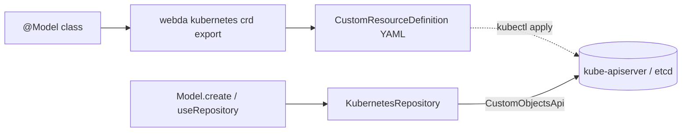

# Kubernetes Store

`KubernetesStore` stores models as Kubernetes custom resources: the API server (etcd) is the database, and the objects
can be read and edited with `kubectl` or a GitOps tool. Pair it with the [Kubernetes operator](./KubernetesOperator.md)
to reconcile them.



## Is it a good fit?

It makes sense for **configuration and control-plane models** (tenants, environments, feature flags, routing rules...),
not as a general-purpose store.

| Aspect      | Kubernetes reality                                      | Consequence                                                                                      |
| ----------- | ------------------------------------------------------- | ------------------------------------------------------------------------------------------------ |
| Object size | etcd limit of ~1.5 MiB per object                       | No big or binary data (use a `BinaryService`)                                                    |
| Volume      | Not a database, every object is watched by informers    | Tens to thousands of objects, not user data                                                      |
| Query       | Only label and field selectors                          | `=` and `IN` on `labelFields` are filtered by the API server, the rest of the query in memory    |
| Atomic ops  | No increment, optimistic concurrency on resourceVersion | Increments, conditions and collections are read-modify-write, retried on conflict (`maxRetries`) |
| Names       | DNS subdomain, lowercase, at most 253 characters        | The primary key is the name: a composite key needs `-` or `.` as `PrimaryKeySeparator`           |
| Schema      | Structural OpenAPI v3                                   | The stored JSON schema is converted (references inlined, unsupported keywords dropped)           |

## Configuration

```json title="webda.config.json"
{
  "services": {
    "tenantStore": {
      "type": "Webda/KubernetesStore",
      "group": "myapp.example.com",
      "namespace": "tenants",
      "models": ["MyApp/Tenant"],
      "labelFields": { "MyApp/Tenant": ["plan"] },
      "statusFields": { "MyApp/Tenant": ["ready"] }
    }
  }
}
```

| Parameter                      | Default                           | Description                                                        |
| ------------------------------ | --------------------------------- | ------------------------------------------------------------------ |
| `group`                        | required                          | API group of the custom resources                                  |
| `version`                      | `v1`                              | API version                                                        |
| `namespace`                    | `default`                         | Namespace of the resources, ignored for the `Cluster` scope        |
| `scope`                        | `Namespaced`                      | `Namespaced` or `Cluster`                                          |
| `labelFields`                  | `{}`                              | Fields mirrored as labels, by model identifier                     |
| `statusFields`                 | `{}`                              | Fields written through the status subresource, by model identifier |
| `installCrds`                  | `false`                           | Create or update the definitions at init                           |
| `maxRetries`                   | `5`                               | Attempts of a read-modify-write on conflicts                       |
| `watch`                        | `false`                           | Emit the events of the changes made by others (see below)          |
| `config`, `context`, `timeout` | in-cluster or kubeconfig, 10000ms | Kubernetes client                                                  |

## Mapping

Each model of `models` is a CustomResourceDefinition `<plural>.<group>`, its kind the class name of the model. Its
subclasses share its resources: their model identifier is in the `webda.io/model` annotation (and label), and the
definition keeps the fields its schema does not declare.

```yaml
apiVersion: myapp.example.com/v1
kind: Tenant
metadata:
  name: acme # primary key
  namespace: tenants
  labels:
    webda.io/model: MyApp.Tenant
    plan: premium # labelFields
  annotations:
    webda.io/model: MyApp/Tenant
spec: # stored fields, without the primary key and the status fields
  displayName: ACME
  plan: premium
status: # statusFields, written through the status subresource
  ready: true
```

- Resources created with `kubectl` (no `webda.io/model` annotation) belong to the model of the definition. They need
  the labels of the `labelFields` too, to be found by a query on them.
- A label field must hold label-compatible values (at most 63 alphanumeric, `-`, `_` or `.` characters): another value
  is refused on write.
- A status-only change is one write to the status subresource and does not change `metadata.generation`.

## Changes made by others

With `watch: true`, the store watches its resources and emits the repository events of the changes made outside the
application (kubectl, GitOps, another replica), on the repository of the object's model:

```typescript
useRepository(Tenant).on("Updated", ({ object_id, object }) => {
  // object is the new Tenant
});
```

- `Created`, `Updated` (with the object) and `Deleted` (with its key): the objects existing when the store starts emit
  nothing, nor do the changes of metadata only (labels, finalizers, operator conditions).
- The writes of the application emit their usual events once: the store remembers the resource versions it wrote and
  skips their watch events.
- After the watch reconnects, the changes made meanwhile are emitted.
- The service account needs `watch` on the resources (`webda kubernetes rbac export` grants it).

## Definitions and rights

```bash
# One CustomResourceDefinition per model
webda kubernetes crd export --target ./crds
# The Roles (per namespace), ClusterRole and bindings the stores and operators need
webda kubernetes rbac export --target ./rbac.yaml --serviceAccount my-app --serviceAccountNamespace apps
kubectl apply -f ./crds -f ./rbac.yaml
```

With `installCrds: true` the store creates or updates the definitions at init instead: its service account then needs
`get`, `create` and `update` on `customresourcedefinitions.apiextensions.k8s.io`.
