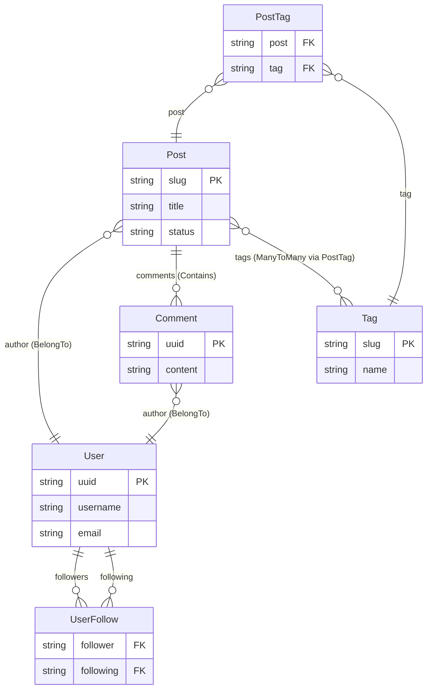

# Model Relationships

`@webda/models` provides typed relationship helpers for common cardinality patterns and references to different model types. All relationships are declared as TypeScript field types; the framework infers the store graph at build time.

## Relationship types at a glance

| Type | Cardinality | Ownership | Blog-system example |
|------|-------------|-----------|---------------------|
| `BelongTo<T>` | Many-to-one | No | `Comment.author → User` |
| `Contains<T>` | One-to-many | Yes (cascade delete) | `Post.comments → [Comment]` |
| `OneToMany<T, Owner, Field>` | One-to-many | No | `User.posts → [Post]` (via `Post.author`) |
| `ManyToMany<T>` | Many-to-many | Via join table | `Post.tags ↔ [Tag]` (via `PostTag`) |
| `RelateTo<T>` | Soft reference | No | — |
| `ModelLinksAny<K, T>` | Polymorphic references | No | `Report.links → [Task, PullRequest, ...]` |

## BelongTo — Many-to-one reference

`BelongTo<T>` stores the primary key of the referenced model. It creates a "belongs to" foreign key relationship.

```typescript
import { UuidModel, BelongTo } from "@webda/models";
import type { User } from "./User";
import type { Post } from "./Post";

export class Comment extends UuidModel {
  content!: string;

  post!: BelongTo<Post>;    // Comment belongs to a Post
  author!: BelongTo<User>;  // Comment belongs to a User
}
```

REST implications:
- `Comment.postId` (the raw FK) is stored in the document
- `GET /comments/:uuid` includes the `postId` field
- Resolving the Post requires a separate `GET /posts/:slug`

## Contains — One-to-many with ownership

`Contains<T>` declares that the model "owns" the child models. The children are stored separately but associated with the parent.

```typescript
import { Model, WEBDA_PRIMARY_KEY, Contains } from "@webda/models";
import type { Comment } from "./Comment";

export class Post extends Model {
  [WEBDA_PRIMARY_KEY] = ["slug"] as const;

  slug!: string;
  title!: string;
  content!: string;

  comments!: Contains<Comment>;   // Post contains/owns Comments
}
```

REST implications:
- `GET /posts/:slug/comments` — list all comments for this post
- `POST /posts/:slug/comments` — create a comment on this post
- Deleting the Post cascades to its Comments

## OneToMany — One-to-many via foreign key

`OneToMany<T, Owner, Field>` is the inverse side of a `BelongTo`. It exposes a queryable collection without ownership.

```typescript
import { UuidModel, OneToMany } from "@webda/models";
import type { Post } from "./Post";
import type { UserFollow } from "./UserFollow";

export class User extends UuidModel {
  username!: string;
  email!: string;

  // Posts where Post.author = this user
  posts!: OneToMany<Post, User, "author">;

  // Followers (users who follow this user, via UserFollow.following)
  followers!: OneToMany<UserFollow, User, "following">;

  // Following (users this user follows, via UserFollow.follower)
  following!: OneToMany<UserFollow, User, "follower">;
}
```

REST implications:
- `GET /users/:uuid/posts` — list all posts by this user (queryable with WQL)

## ManyToMany — Many-to-many via join table

`ManyToMany<T>` expresses a many-to-many relationship. It requires a join table model on both sides.

```typescript
// Post side
import { ManyToMany } from "@webda/models";
import type { Tag } from "./Tag";

export class Post extends Model {
  tags!: ManyToMany<Tag>;
}

// Tag side
import { OneToMany } from "@webda/models";
import type { Post } from "./Post";

export class Tag extends Model {
  posts!: OneToMany<Post, Tag, "tags">;
}

// Join table — PostTag
import { Model, WEBDA_PRIMARY_KEY, BelongTo } from "@webda/models";
import type { Post } from "./Post";
import type { Tag } from "./Tag";

export class PostTag extends Model {
  [WEBDA_PRIMARY_KEY] = ["post", "tag"] as const;

  post!: BelongTo<Post>;
  tag!: BelongTo<Tag>;
}
```

REST implications:
- `GET /posts/:slug/tags` — list all tags for a post
- `POST /posts/:slug/tags/:tagSlug` — add a tag to a post
- `DELETE /posts/:slug/tags/:tagSlug` — remove a tag from a post

## Self-referential (User follows User)

```typescript
import { UuidModel, OneToMany } from "@webda/models";
import type { UserFollow } from "./UserFollow";

export class User extends UuidModel {
  followers!: OneToMany<UserFollow, User, "following">;
  following!: OneToMany<UserFollow, User, "follower">;
}
```

```typescript
// UserFollow join table — composite key
import { Model, WEBDA_PRIMARY_KEY, BelongTo } from "@webda/models";
import type { User } from "./User";

export class UserFollow extends Model {
  [WEBDA_PRIMARY_KEY] = ["follower", "following"] as const;

  follower!: BelongTo<User>;
  following!: BelongTo<User>;
  createdAt!: Date;
}
```

## Querying relations at runtime

All relation types expose a `.query(wql)` method that returns paginated results:

```typescript
// Get all published posts by a user
const { results } = await user.posts.query(`status = 'published' ORDER BY createdAt DESC LIMIT 10`);

// Get recent comments on a post
const { results: comments } = await post.comments.query(`ORDER BY createdAt DESC LIMIT 5`);
```

## Relationship graph diagram (blog-system)



## Verify

```bash
cd packages/models
npx vitest run src/relations.spec.ts
```

```
✓ packages/models/src/relations.spec.ts — all tests pass
```

## See also

- [Defining Models](./Defining-Models.md) — base classes and primary keys
- [Lifecycle](./Lifecycle.md) — hooks that fire on relation changes
- [Actions](./Actions.md) — custom operations on relations
- [WQL Syntax](../ql/Syntax.md) — the query language for relation queries

## ModelLinksAny — References to different model types

Use `ModelLinksAny<CustomData, Target>` for a collection whose targets can belong to different model classes:

```typescript
import { ModelLinksAny, UuidModel } from "@webda/models";
import { findModelBacklinks } from "@webda/core";
import { Task } from "./Task.js";
import { PullRequest } from "./PullRequest.js";

export class Report extends UuidModel {
  links!: ModelLinksAny<{ rel: string }>;
  // Optional constraint: only these exact registered model identifiers.
  deliverables!: ModelLinksAny<{ rel: string }, Task | PullRequest>;
}

report.links.add(task, { rel: "implements" });
const target = await report.links[0].get();
await report.save();

for await (const backlink of findModelBacklinks(task, { models: ["App/Report"] })) {
  console.log(backlink.model, backlink.key, backlink.attribute, backlink.references);
}
```

The content mapper creates an empty attached collection on first access. To use the container without generated accessors, initialize it yourself with `new ModelLinksAny()` or `new ModelLinksAny([Task, PullRequest])` for constrained targets. Use `add`, `set`, `push`, `remove`, `pop`, indexed access, `at`, iteration, `map`, and `filter` to work with references. `remove(target)` removes all references to that model and primary key.

Stored data and REST/MCP payloads contain references, never embedded target objects:

```json
[
  { "model": "App/Task", "key": "task-123", "rel": "implements" },
  { "model": "App/PullRequest", "key": { "repository": "webda.io", "number": 42 }, "rel": "delivers" }
]
```

Use the canonical, case-sensitive identifier registered in the application. Keys can be nonempty strings, finite numbers, or composite objects with string/number values. The compiler records constrained target identifiers in `Relations.polymorphicLinks` and in the generated input, output and stored JSON Schemas. Custom data cannot shadow `model`, `key`, reference methods, or GraphQL's `target` field.

Every `.get()` resolves through the **active application** and checks the current caller's `canAct(context, "get")`. It does not cache a target, even if the link was added from a loaded model. An unknown identifier, deleted target, or unreadable target answers with the same missing-object error. Standalone `@webda/models` integrations must install a permission-aware loader with `setModelLinkLoader`; reads fail without one.

There is no cascade, target-existence check when adding a reference, or automatic cleanup. Deleting a target leaves a dangling reference that can still carry useful application metadata. Applications choose when to remove or repair it.

`findModelBacklinks` checks permission on the target and each source object, skips private attributes, and matches both identity fields in the same array element. It performs a portable paginated scan of source models declaring polymorphic links. Restrict `models` for large applications. By default it yields at most 100 matching source attributes and examines at most 10,000 source rows and requests at most 10,000 store pages; set `limit` and `scanLimit` explicitly when needed. Exceeding the scan budget throws, so consumers must handle failure even after earlier entries have been yielded. Backlink visibility follows each source model's read policy. Applications needing indexed lookups can implement store-specific queries over the stored references.

GraphQL exposes each reference's `model`, `key`, and custom fields, plus a `target` union containing the allowed models exposed by that GraphQL service. Unconstrained links use all exposed models. Selecting `target` performs the same permission check as reading the object directly:

```graphql
{
  report(uuid: "report-123") {
    links {
      model
      key
      rel
      target {
        __typename
        ... on Task { uuid }
        ... on PullRequest { uuid }
      }
    }
  }
}
```

Actual root/type names follow the service's model naming configuration. Unreadable or dangling targets resolve to `null` with a `NOT_FOUND` error. Reference metadata remains visible to callers who can read the report, so avoid putting target secrets in custom link data. When none of the possible target models is exposed, GraphQL provides the reference fields only.
