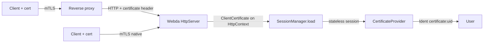

# Client certificates (mTLS)

Webda can authenticate requests with X.509 TLS client certificates, in two modes:

- **Native**: the `HttpServer` terminates TLS, requests the client certificate and verifies it against a CA.
- **Proxy**: a reverse proxy (Traefik, nginx, Envoy) terminates mTLS and forwards the verified certificate in a header.
  Webda only accepts that header from its `trustedProxies`.

The certificate is exposed on the request, `CertificateProvider` from `@webda/auth` turns it into a user session and
`ClientCertificateFilter` can reserve paths to certificate holders.



## Native mode

```jsonc
{
  "services": {
    "HttpServer": {
      "key": "/certs/tls.key",
      "cert": "/certs/tls.crt",
      "clientCa": "/certs/ca.crt", // or a list of files
      "clientAuth": "optional" // "none" | "optional" | "require"
    }
  }
}
```

| `clientAuth` | Behaviour                                                                                                                                                                    |
| ------------ | ---------------------------------------------------------------------------------------------------------------------------------------------------------------------------- |
| `none`       | No certificate is requested (default without `clientCa`)                                                                                                                     |
| `optional`   | A certificate is requested; clients without one, or with one not signed by `clientCa`, still connect. The latter is exposed with `verified: false` (default with `clientCa`) |
| `require`    | The TLS handshake fails for clients without a certificate signed by `clientCa`                                                                                               |

`clientCa`/`clientAuth` need TLS (`key` and `cert`, or `autoTls`): the server refuses to start otherwise. The plain
HTTP to HTTPS redirect of the TLS port keeps working. HTTP/1.1, HTTP/2, gRPC and GraphQL subscriptions (WebSocket)
expose the certificate the same way.

## Proxy mode

```jsonc
{
  "services": {
    "HttpServer": {
      "trustedProxies": "10.0.0.0/8",
      "clientCertHeader": "x-forwarded-tls-client-cert",
      "clientCertHeaderFormat": "traefik" // "traefik" | "pem-urlencoded" | "xfcc"
    }
  }
}
```

| Proxy                                        | `clientCertHeader`            | `clientCertHeaderFormat` |
| -------------------------------------------- | ----------------------------- | ------------------------ |
| Traefik `passTLSClientCert` with `pem: true` | `x-forwarded-tls-client-cert` | `traefik`                |
| nginx `$ssl_client_escaped_cert`             | `x-ssl-client-cert`           | `pem-urlencoded`         |
| Envoy `forward_client_cert_details`          | `x-forwarded-client-cert`     | `xfcc`                   |

- A request carrying `clientCertHeader` from an address outside `trustedProxies` is refused with a 400, like the
  `X-Forwarded-*` headers.
- The leaf certificate is used (first of the Traefik chain, last XFCC element: the one added by the closest proxy,
  configure Envoy with `SANITIZE_SET`).
- A forwarded certificate is considered `verified`: configure the proxy to verify it (Traefik
  `RequireAndVerifyClientCert` or `VerifyClientCertIfGiven`, nginx `ssl_verify_client on|optional`). Never use a mode
  that forwards unverified certificates, such as Traefik `RequestClientCert`.
- A malformed header is ignored (logged as a warning).
- Requests from a trusted proxy only use the header: when the proxy connects to Webda over TLS with its own client
  certificate, that certificate is never taken for the client's.

:::warning

In proxy mode, `trustedProxies` is the application-level guard only. Make sure that nothing but the proxy can reach
Webda (Kubernetes `NetworkPolicy`, security groups...), otherwise anyone in the trusted range can forge the header.

:::

## Reading the certificate

```typescript
const cert = useContext<WebContext>().getHttpContext().getClientCertificate();
if (cert?.verified) {
  cert.subject.CN; // "alice", a repeated attribute (several OU) is a string[]
  cert.subjectDN; // "O=Webda, OU=dev, CN=alice"
  cert.issuer; // same for the issuer, cert.issuerDN
  cert.san; // ["email:alice@example.com", "URI:spiffe://example.com/alice"]
  cert.fingerprint256; // "AB:CD:..."
  (cert.serialNumber, cert.validFrom, cert.validTo, cert.raw); // raw is the PEM
  cert.source; // "tls" | "proxy"
}
```

## CertificateProvider

`CertificateProvider` is an [authentication](./Authentication.md) provider (`providerName` `certificate`) mapping
verified certificates to users through an `Ident` `<uid>:certificate`.

```jsonc
{
  "services": {
    "Authentication": { "type": "Webda/Authentication" },
    "CertificateProvider": {
      "type": "Webda/CertificateProvider",
      "mode": "login", // "login" (default) | "factor"
      "identityField": "san.email", // "fingerprint256" (default) | "subject.CN" | "san.email" | "san.uri"
      "allowedIssuers": ["webda-client-ca"], // issuer CN or DN, optional
      "allowedSubjects": ["^O=Webda, "], // regexps on the subject DN, optional
      "autoRegister": false, // default false
      "roles": { "OU=admins": ["admin"] }, // optional
      "cacheTtl": 60000 // ms, default 60000, 0 disables
    }
  }
}
```

Each request presenting a verified, accepted certificate of a known user gets a **stateless** session (no cookie is
written): `provider` is `certificate`, `amr` is `["mtls"]` and `roles` come from the `roles` mapping. Permission queries
can rely on it, for example `amr CONTAINS 'mtls'`.

Set `mode: "factor"` to require an existing cookie or Bearer session. The certificate must be linked to that same
user; then `mtls` is added to the request's `amr` while the original provider and MFA state remain intact. A
certificate alone never logs a user in or registers one in this mode, even if `autoRegister` is set. Certificate roles
are not added to the existing session. The added `mtls` method is only present while the certificate is presented:
it is not saved in the cookie or included in newly issued access and refresh tokens. In factor mode,
`Auth.Certificate.Link` returns `{ "status": "linked" }` without logging in again or issuing tokens.

In `login` mode, session precedence is a `Bearer` token, then the certificate, then the session cookie. An unknown or
refused certificate falls back to the cookie session. In `factor` mode, the Bearer or cookie session is loaded first,
then the matching certificate adds `mtls` for that request.

- `identityField`: `fingerprint256` pins one certificate (a renewed certificate must be linked again), the other fields
  survive a renewal but trust the CA not to issue the same subject or SAN to someone else.
- A certificate is accepted when it is valid now, its issuer CN or DN is in `allowedIssuers` (when set) and its subject
  DN matches one of `allowedSubjects` (when set).
- `autoRegister`: the first request of an unknown certificate goes through `Authentication.complete()`; the
  `registration` and `linking` policies apply (the email of the certificate is not considered verified), and the usual
  `Authentication.Register`/`Authentication.Login` events are emitted.
- Without `autoRegister`, a logged user links the certificate presented with the request with
  `POST /auth/certificate/link` (operation `Auth.Certificate.Link`). It fails with 401 without login, 403 without a
  verified and accepted certificate, `IDENT_LINKED_ELSEWHERE` when it belongs to another user. Unlink it with
  `Auth.Unlink` (`provider: "certificate"`).
- Resolved certificates are cached `cacheTtl` ms per instance: an unlink is effective at once on the instance that
  handled it, after `cacheTtl` on the others.
- In `login` mode, certificate sessions skip the MFA step: the certificate is the possession factor. In `factor` mode,
  the certificate does not finish an MFA session that is still pending another method.

:::warning

Browsers present client certificates automatically, cross-site requests included: like a cookie without `SameSite`, a
certificate session is an ambient credential. For browser clients keep an origin check (`csrfOrigins`) on the
state-changing routes, or reserve certificate authentication to non-browser clients.

:::

## ClientCertificateFilter

A request filter (`request-filter` capability, like [Hawk](./Hawk.md)) allowing requests presenting a verified certificate:

```jsonc
{
  "services": {
    "CertOnly": {
      "type": "Webda/ClientCertificateFilter",
      "paths": ["^/internal/"] // regexps on the relative path, all paths when undefined
    }
  }
}
```

Request filters are combined with OR: a request is allowed when any filter allows it. With this filter alone, only
certificate holders reach `paths`, every other request is refused (403).

## Revocation

CRL and OCSP are not checked. Prefer short-lived certificates (cert-manager renews them) and unlink a compromised
certificate with `Auth.Unlink`.

See [Traefik and cert-manager](../Deployments/Kubernetes/Traefik-mTLS.md) for a Kubernetes setup.
