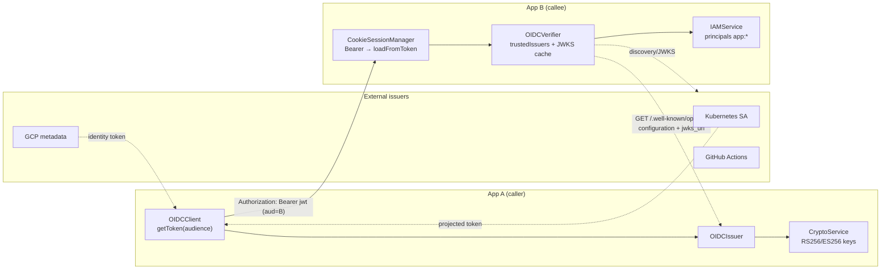
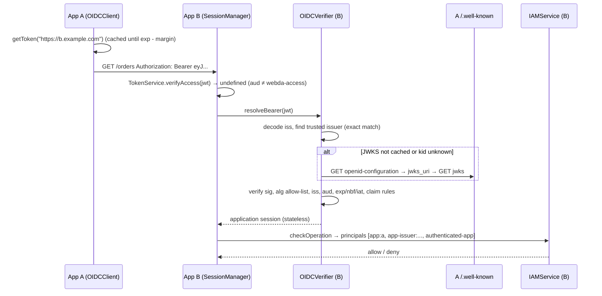

# Application trust with OIDC

`@webda/oidc` lets Webda applications call each other **without a shared secret**. The caller presents a short-lived
JWT signed with its own asymmetric key. The callee verifies it against the caller's public JWKS, found through standard
OpenID Connect discovery, and turns the caller into an *application principal* that IAM policies can target.

The same verifier accepts tokens from any OIDC issuer that publishes discovery and JWKS: Kubernetes service accounts,
GitHub Actions, GCP service accounts...

It is about **workloads** (applications, jobs, CI), not users: user login stays with `@webda/auth`.



## Services

| Service              | Role                                                                                       |
| -------------------- | ------------------------------------------------------------------------------------------ |
| `Webda/OIDCIssuer`   | Publishes `/.well-known/openid-configuration` and mints audience-scoped workload tokens    |
| `Webda/OIDCVerifier` | Trusts a list of issuers, turns a valid `Authorization: Bearer` into an application session |
| `Webda/OIDCClient`   | Gets a token for a target audience and calls other applications with it                    |

### OIDCIssuer

The issuer signs with the `CryptoService` asymmetric keys and publishes them through the `CryptoService` JWKS route,
so the `CryptoService` needs an `url`.

| Parameter   | Default                  | Description                                                                         |
| ----------- | ------------------------ | ----------------------------------------------------------------------------------- |
| `issuer`    | required                 | Public URL, `https` (plain `http` is only accepted for `localhost`), no query       |
| `name`      | application package name | Tokens carry `sub: app:<name>` and `webda_app: <name>`                               |
| `tokenTtl`  | `300`                    | Token lifetime in seconds                                                           |
| `algorithm` | `RS256`                  | `RS256`, `RS384`, `RS512`, `PS256` or `ES256` (EC keys). Symmetric algorithms are refused |
| `audiences` | `["*"]`                  | Audiences this application may mint tokens for (globs, `*` does not cross `/`)      |

`useOIDCIssuer().mint(audience, extraClaims?)` returns `{ token, expiresAt }`. Extra claims cannot override `iss`,
`sub`, `aud`, `exp`, `nbf`, `iat`, `jti` nor `webda_app`.

The JWKS published by the `CryptoService`:

- uses the `kid` written in the tokens (`A<keyId>`), with `use: "sig"`;
- advertises `alg` only when the `CryptoService` `jwt.algorithm` is asymmetric: the issuer then refuses to start with
  another algorithm;
- never contains symmetric keys nor private parts;
- keeps the keys of previous rotations while they are in the registry, so tokens signed before a rotation still verify;
- is served with `Cache-Control: public, max-age=…` (a tenth of `keyActiveLifespan`, between 1 minute and 1 hour,
  10 minutes by default).

### OIDCVerifier

| Parameter        | Default | Description                                                     |
| ---------------- | ------- | --------------------------------------------------------------- |
| `audience`       | required | Default expected audience, usually this application public URL |
| `trustedIssuers` | `[]`    | See below                                                       |
| `clockTolerance` | `30`    | Clock skew in seconds                                           |
| `maxTokenAge`    | `3600`  | Max lifetime (`exp - iat`) in seconds                            |
| `jwksCacheTtl`   | `600`   | Discovery and JWKS cache in seconds                             |
| `requestTimeout` | `5000`  | Discovery and JWKS request timeout in milliseconds              |

Each trusted issuer:

| Field         | Default                                   | Description                                                            |
| ------------- | ----------------------------------------- | ---------------------------------------------------------------------- |
| `issuer`      | required                                  | Compared **exactly** to the token `iss`                                |
| `jwksUri`     | discovered                                | Skip discovery, useful for issuers that are not URLs                   |
| `audiences`   | `[audience]`                              | Accepted audiences                                                     |
| `algorithms`  | `["RS256", "ES256"]`                      | Never `none` nor `HS*`                                                 |
| `claims`      | `{}`                                      | Conditions on claims, all must match. Values are globs (`*` does not cross `/`), a list means any of |
| `principal`   | `${sub}`                                  | Template over the claims. A leading `app:` is removed                   |
| `groups`      | `[]`                                      | Static groups, seen by IAM as `app-group:<group>`                       |
| `maxTokenAge` | the verifier `maxTokenAge`                | Per-issuer max lifetime                                                |
| `session`     | `application`                             | `application` (workload tokens) or `user`, see [User sessions](#user-sessions) |

`useOIDCVerifier().verify(token)` returns the `AppIdentity` or `undefined`, `verifyOrFail(token)` throws an
`OIDCTokenInvalid` (401).

### OIDCClient

| Parameter       | Default      | Description                                                         |
| --------------- | ------------ | ------------------------------------------------------------------- |
| `source`        | `self`       | `self`, `file`, `gcp-metadata` or `github-actions`                  |
| `tokenFile`     |              | For `file`: the projected token path                                |
| `issuerService` | `OIDCIssuer` | For `self`: the issuer service name                                 |
| `refreshMargin` | `60`         | Seconds before expiration when a cached token is renewed            |
| `requestTimeout`| `5000`       | Token request timeout in milliseconds                               |

Sources:

- `self`: minted by this application `OIDCIssuer`.
- `file`: read again on every refresh, as the kubelet rotates it. The audience is fixed by the pod spec: asking for
  another one throws.
- `gcp-metadata`: identity token of the default service account from the metadata server.
- `github-actions`: from `ACTIONS_ID_TOKEN_REQUEST_URL` / `ACTIONS_ID_TOKEN_REQUEST_TOKEN`, the workflow needs
  `permissions: id-token: write`.

Tokens are cached per audience, and concurrent calls share a single request.

```ts
import { useOIDCClient } from "@webda/oidc";

// Audience defaults to the url origin: https://billing.example.com
const res = await useOIDCClient().fetch("https://billing.example.com/invoices", {
  method: "POST",
  body: JSON.stringify({ amount: 10 })
});
```

## Request flow



The `SessionManager` tries the `TokenService` access tokens first, then every registered `BearerTokenResolver`
(`registerBearerResolver()` in `@webda/core`). A Bearer that nobody accepts gives an anonymous session: the cookie is
never used as a fallback.

## Application sessions

A verified token gives a **stateless** session with `session.application` set:

```ts
{
  principal: "orders",
  issuer: "https://orders.example.com",
  subject: "app:orders",
  groups: [],
  claims: { ... } // the verified claims
}
```

`session.isApplication()` is true, `amr` is `["oidc"]` and `provider` is the issuer. An application session has **no
user**: `getCurrentUserId()` is `undefined` and `isLogged()` is `false`, so ownership checks (`OwnerModel`) and
user-only operations never mistake an application for a user. Mapping an application to a user is up to the
application.

## User sessions

A trusted issuer with `session: "user"` is a Webda `OAuthServer` whose access tokens are bound to this application
(its `resources`, see the `@webda/oauth` documentation). A verified token gives a **stateless user session**, like a
local access token: `userId` is `sub`, with the `ident`, `provider`, `amr`, MFA state, `authAt`, `roles`, the token
`scope` (enforced on every operation) and `client_id`.

```jsonc
"trustedIssuers": [{ "issuer": "https://auth.example.com", "session": "user", "claims": { "client_id": "my" } }]
```

- Only `typ: at+jwt` tokens with the `sub`, `ident` and `fam` claims are accepted. An `application` issuer refuses
  the tokens carrying these claims (it still accepts the `at+jwt` client credentials tokens of other issuers): a
  user access token never authenticates an application, nor a workload token a user.
- The refresh family is not kept: it belongs to the issuer. Revocations and password changes on the issuer are only
  seen when the token expires.
- Discovery falls back to the RFC 8414 metadata (`/.well-known/oauth-authorization-server`) published by the
  `OAuthServer`.

## IAM

`IAMService` gives an application session these principals:

| Principal               | Meaning                                       |
| ----------------------- | --------------------------------------------- |
| `app:<principal>`       | The application                               |
| `app-issuer:<issuer>`   | Any application of this issuer                |
| `app-group:<group>`     | The static groups of its trusted issuer       |
| `authenticated-app`     | Any verified application                      |

Users keep `user:<id>`, `group:<name>`, `authenticated`; neither side gets the other's principals. Conditions can read
`r.ctx.application` (`principal`, `issuer`, `subject`, `groups`, `claims`).

```jsonc
"IAMService": {
  "type": "Webda/IAMService",
  "scope": ["Invoices.*", "Orders.*"],
  "policies": [
    { "name": "InvoiceWriter", "statements": [{ "effect": "allow", "operations": ["Invoices.Create"] }] },
    { "name": "OrdersReader", "statements": [{ "effect": "allow", "operations": ["Orders.Get", "Orders.Query"] }] },
    {
      "name": "MainBranchDeploy",
      "statements": [
        { "effect": "allow", "operations": ["Orders.*"], "condition": "r.ctx.application.claims.ref == 'refs/heads/main'" }
      ]
    }
  ],
  "attachments": {
    "app:orders": ["InvoiceWriter"],
    "app:repo:loopingz/orders:*": ["OrdersReader"],
    "app-issuer:https://token.actions.githubusercontent.com": ["MainBranchDeploy"]
  }
}
```

`IAMPolicyAttachment` models accept the same principals.

## Configuration example

```jsonc
// App A (orders)
"services": {
  "CryptoService": { "url": "/jwks", "jwt": { "algorithm": "RS256" } },
  "OIDCIssuer": { "type": "Webda/OIDCIssuer", "issuer": "https://orders.example.com", "name": "orders" },
  "OIDCClient": { "type": "Webda/OIDCClient", "source": "self" }
}
// App B (billing)
"services": {
  "OIDCVerifier": {
    "type": "Webda/OIDCVerifier",
    "audience": "https://billing.example.com",
    "trustedIssuers": [
      { "issuer": "https://orders.example.com", "claims": { "sub": "app:orders" } },
      {
        "issuer": "https://token.actions.githubusercontent.com",
        "claims": { "repository": "loopingz/*", "ref": "refs/heads/main" },
        "principal": "gha:${repository}"
      },
      {
        "issuer": "https://kubernetes.default.svc.cluster.local",
        "claims": { "sub": "system:serviceaccount:prod:*" }
      }
    ]
  }
}
```

Principal names are shared by all the trusted issuers: give each external issuer a distinct `principal` template
(`gha:${repository}`, `k8s:${sub}`...) so that one issuer cannot produce the principal of another.

### Kubernetes

Project a token with the audience of the called application, and read it with the `file` source:

```yaml
volumes:
  - name: webda-token
    projected:
      sources:
        - serviceAccountToken:
            path: webda
            audience: https://billing.example.com
            expirationSeconds: 600
```

```jsonc
"OIDCClient": { "type": "Webda/OIDCClient", "source": "file", "tokenFile": "/var/run/secrets/tokens/webda/webda" }
```

The callee trusts the cluster issuer (`kubectl get --raw /.well-known/openid-configuration`). Its discovery must be
reachable from the callee: either a public issuer (managed clusters) or the `system:service-account-issuer-discovery`
role bound to unauthenticated callers. Set `jwksUri` when the issuer is not an URL.

## Security

- Only configured issuers are contacted: an unknown `iss` is refused without any network request, so a token cannot
  make the verifier fetch an attacker URL.
- The discovery document must announce the configured `issuer`, its `jwks_uri` must be `https`.
- `none` and `HS*` are never accepted, whatever the `kid`: no algorithm confusion with a public key.
- `iss`, `aud`, `exp`, `nbf`, `iat` are checked with `clockTolerance`; `exp - iat` above `maxTokenAge` is refused.
- An unknown `kid` refetches the JWKS at most once per 30 seconds.
- Refusals are logged at `DEBUG` with the reason, never with the token, and counted in
  `webda_oidc_verify_total{issuer,result}` (untrusted issuers share the `untrusted` label).
- Tokens are short-lived and audience-scoped: a token for billing is useless against another application.

Token exchange (RFC 8693), mTLS-bound tokens (RFC 8705) and a full OpenID Provider for users are out of scope.

## Sample

`sample-apps/oidc-trust` runs two applications: `orders` calls `billing`, whose IAM allows `app:orders` to create
invoices.
