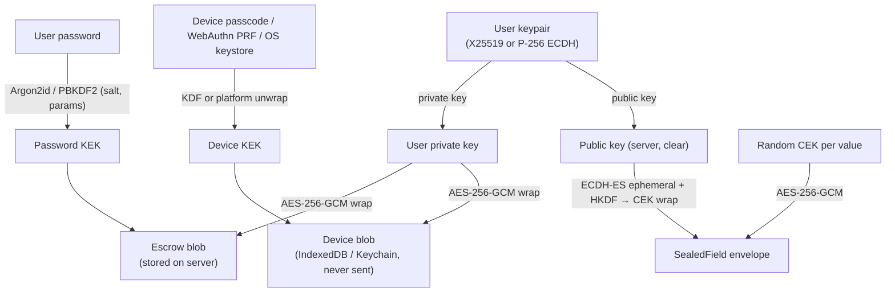
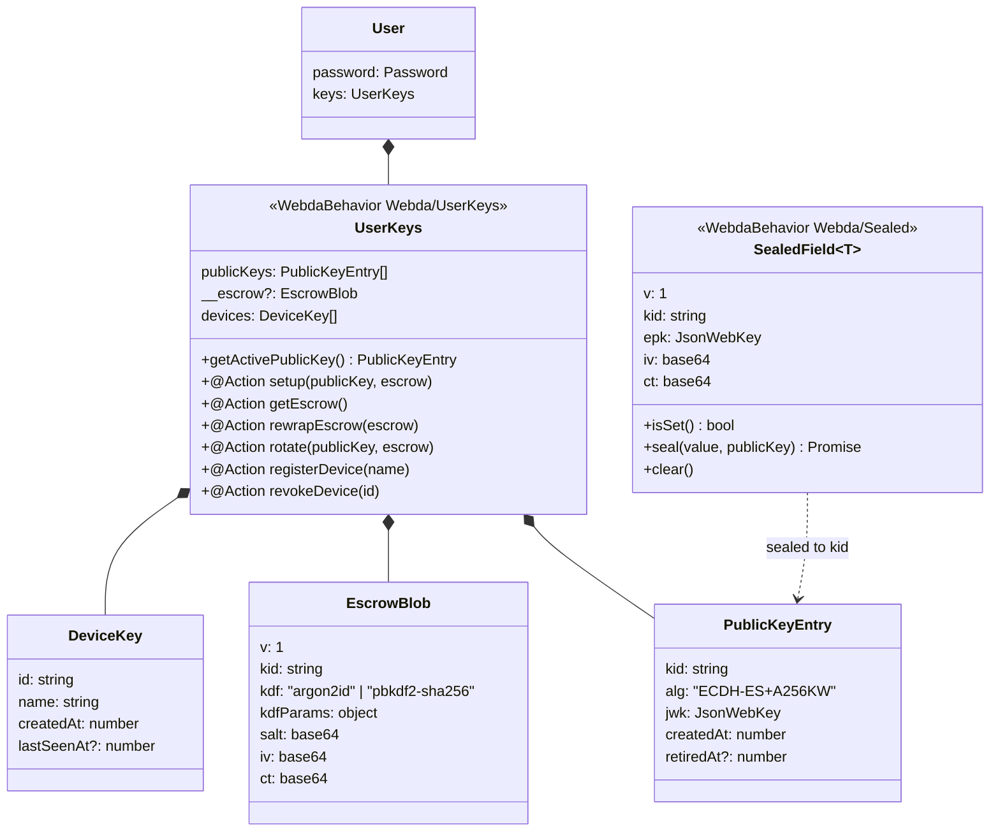
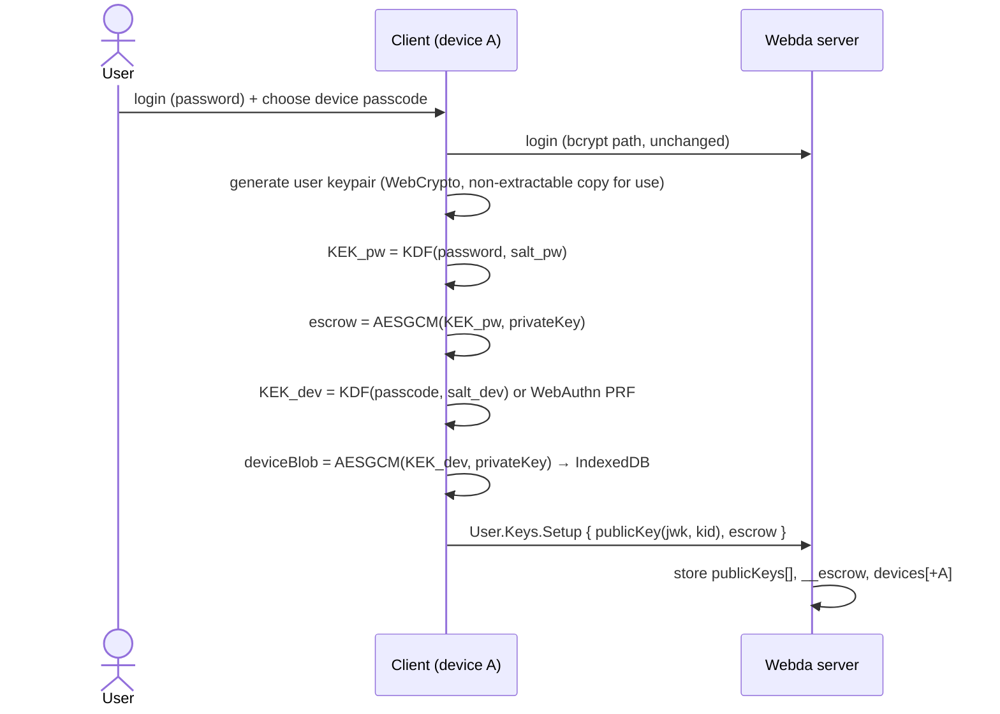
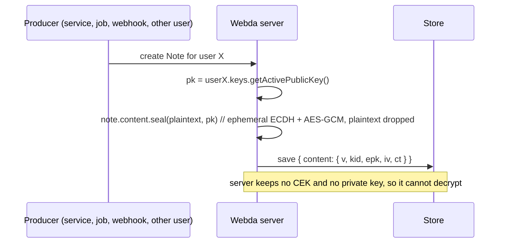
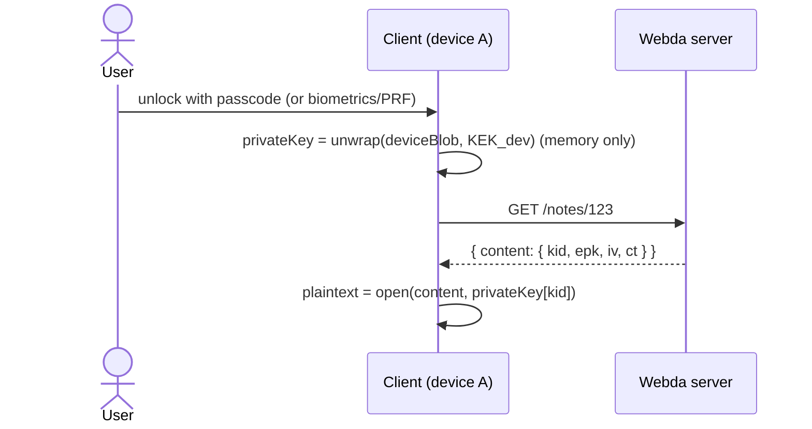
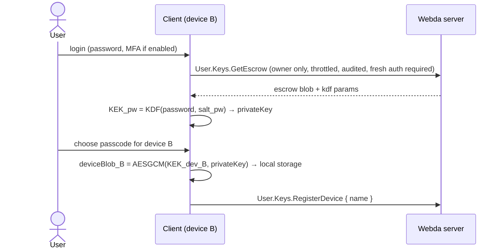
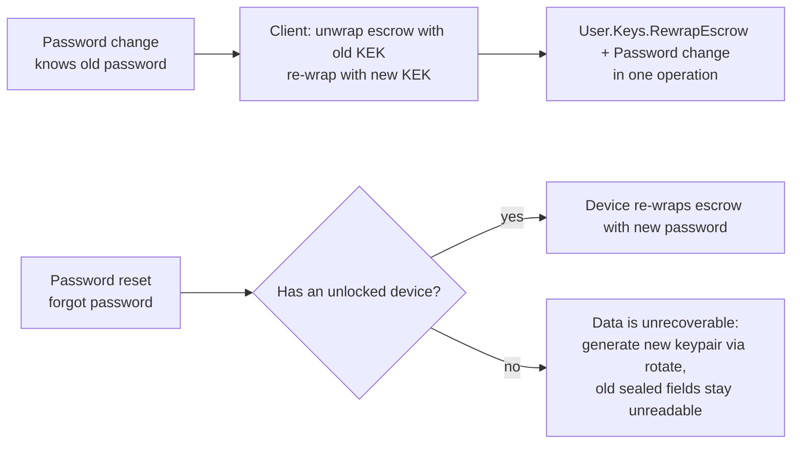

# Sealed fields (end-to-end encrypted model fields) — design

- **Date:** 2026-10-19
- **Issue:** loopingz/webda.io#879 (body reproduced below as the base design)
- **Amendments:** the issue comment https://github.com/loopingz/webda.io/issues/879#issuecomment-6260091609 (summarised in §A, they take precedence over the base where they differ)
- **Status:** approved (owner asked to implement the issue with the amendments)

## A. Amendments (precedence over §B)

1. **Recovery-code escrow is first-class.** `UserKeys` stores escrow blobs keyed by kind: `password` and/or `recovery`. A recovery code is ≥128 random bits, shown once, Crockford base32 (26 chars, groups of 5), derived with Argon2id like the password escrow. The client offers it at enrollment (skippable) and can create/replace it while unlocked (`User.Keys.SetEscrow`). Either escrow can add a device.
2. **Public key pinning.** Every keyring wrap uses AAD = `"webda-keyring|" + userId + "|" + kid + "|" + fingerprint(publicJwk)` (fingerprint = base64url SHA-256 of the raw uncompressed P-256 point). After unwrapping, the client checks each private key matches its served public key and stores the active fingerprint locally (per user). `KeyVault.seal` and `KeyVault.open` refuse a public key/kid whose fingerprint differs from the pinned one unless the change comes from a rotation done or verified by this device.
3. **Keyring wrapping.** A random 256-bit *keyring key* (AES) is wrapped by each KEK (AES-KW for WebAuthn-PRF/OS KEKs, AES-GCM for password/recovery KDF outputs). The keyring (all private keys as PKCS#8, by kid) is encrypted with the keyring key using AES-GCM and the AAD above. Adding a device or rotating re-wraps 32 bytes; rotation re-encrypts the keyring.
4. **Device-to-device transfer (QR) stays a follow-up**; when built, its verification code is derived on both devices from `SHA-256(devicePublicKey ‖ nonce ‖ userId)`.
5. **Reuse** the proven pieces of loopcenter `plugins/third-party-auth/crypto` (versioned AES-GCM envelope with AAD, ECDH P-256 seal/open with HKDF, Argon2id via `hash-wasm`, frozen test vectors) as the starting point for `packages/core/src/sealed/` (port, do not depend on loopcenter).
6. `SealedField` exposes its envelope cleanly (JSON of the envelope) so plugins can build on it (e.g. a session-bound server unseal in loopcenter); no server-side `get()`/`open()` in core.

### Implementation notes

- **Algorithm label.** Public keys and envelopes use `alg: "ECDH-ES+A256GCM"`, not the base design's `ECDH-ES+A256KW`: there is no key-wrap step, the ECDH-ES (ephemeral P-256) shared secret goes through HKDF-SHA-256 (salt = ephemeral raw point ‖ recipient raw point, info `webda-sealed-v1`) and the result is the AES-256-GCM content key itself.
- **AADs.** Field: `modelType|uuid|field|kid`. Keyring: `"webda-keyring|" + userId + "|" + kid + "|" + fingerprint(publicJwk)`, applied to the keyring ciphertext only. Escrow: the KDF KEKs wrap the 32-byte keyring key with AES-GCM and AAD `"webda-escrow|" + userId + "|" + kind` (`password` or `recovery`); platform KEKs use AES-KW (no AAD). The field AAD binds the model identifier and the primary key: renaming the model or namespace, or migrating records to new keys, makes existing values unreadable unless the devices re-seal them.
- **Recovery code.** 26 Crockford base32 characters (130 bits), displayed as five groups of 5 and a final group of 1 (`XXXXX-XXXXX-XXXXX-XXXXX-XXXXX-X`); input is normalised (case, dashes, spaces, O→0, I/L→1).
- **Client-sealed writes.** `SealedField.set(envelope)` (`<Model>.<Field>.Set`, `PUT`) stores an envelope sealed by a client, authorised by the parent `canAct("<field>.set")`, after checking its shape and that `kid` is the recipient active key; it patches the field only.
- **Keyring refresh and reset.** `User.Keys.GetKeyring` (fresh authentication, not throttled) serves the encrypted keyring and public keys so an unlocked device refreshes a keyring rotated elsewhere (the pinned private key must still be in it). `KeyVault.reset` starts over when every key is lost (new key pair and keyring key via `User.Keys.Rotate`); old values stay unreadable.
- **Password escrow and the login password.** The server receives the login password at each login, so the password escrow protects stored data only, not a compromised running server; recovery-code-only or device-only setups avoid it.

## B. Base design (issue #879 body)

## Summary

Add **end-to-end encrypted ("sealed") model fields**. The server can **write** them, using the user's public key, but can **never read** them. Only the user's devices can decrypt.

- Each user has an asymmetric **user keypair**. The server stores the **public key** in clear.
- The **private key** never reaches the server in clear:
  - **On each device** it is stored encrypted with a key derived from the **device passcode** (or wrapped by a platform key: WebAuthn PRF, Keychain, Android Keystore).
  - **On the server** there is one **escrow copy**, encrypted with a key derived from the **user's password**, so the user can add a new device.
- The server (or another user, or a webhook or job) can create sealed values with the public key alone, without seeing the plaintext.

## Existing Webda concepts to reuse

| Concept | Where | Reuse |
|---|---|---|
| `EncryptedField<T>` behavior (`@WebdaBehavior Webda/Encrypted`) | `packages/core/src/models/encrypted.model.ts` | Same API (`set/get/isSet/clear`) and the same `__ciphertext`-style storage. The new behavior is the asymmetric, client-side version. **`EncryptedField` is server-side at rest; `SealedField` is end-to-end.** |
| `Password` behavior (`@WebdaBehavior Webda/Password`) | `packages/core/src/models/password.model.ts` | Pattern for a credential behavior attached to `User`, hydrated with `__hydrateBehaviors`. |
| `PkiEncrypter`: hybrid RSA-OAEP-256 + AES-256-GCM, kid-based `v1:<kid>:<wrappedKey>:<ct>` format | `packages/core/src/services/pki.encrypter.ts` | Same hybrid **envelope idea** and **versioned, kid-tagged format**. The algorithms change to WebCrypto-friendly ones (below). |
| `AuthenticatedEncryption` (AES-256-GCM `iv\|tag\|ct`) | `packages/core/src/services/authenticatedencryption.ts` | Byte layout for the symmetric part. |
| Behaviors: `@Action`, `canAct` with dotted actions | `docs/pages/concepts/models/Behaviors.md` | Key-management operations exposed as `User.Keys.*` actions. |
| `__` keys never reach a public output | model serialization | Server-only metadata. **Sealed ciphertext must be output** (clients need it), so it uses a normal field name. |
| `AbstractOwnerModel` / `User.canAct` | `core/src/models/ownermodel.model.ts`, `user.model.ts` | Who may fetch the escrow blob or which public key to seal to. |
| `@webda/offline` client | `packages/offline/src/client` | Where client-side decryption hooks in (decrypt on read, keep plaintext only in memory). |
| `@webda/compiler` / content-mapper `@WebdaBehavior` | `packages/content-mapper` | JSON schema for the sealed envelope, plus a `@Sealed` marker so generated clients know which fields to decrypt. |

## Key hierarchy



**Important:** the password KEK must be derived **client-side** with its own salt. It must be **separate from the login hash**: login uses bcrypt on the server (`Password.__hash`), while the KEK never leaves the client. A server that can verify the password must not be able to derive the KEK. See the *Password & login* section.

## Data model



- `UserKeys.devices` is **metadata only**: an audit list and a way to revoke. Device blobs are **never** uploaded.
- `__escrow` is server-only in normal outputs. It is returned **only** by the `getEscrow` action to the authenticated owner, with throttling.
- `SealedField` envelope = compact **JWE-like** object (`ECDH-ES+A256KW` / `A256GCM`). Option: store it as a compact JWE string, so `jose` on the client and `jsonwebtoken`-free server code can interoperate.
- **No `get()` on the server side** of `SealedField`. Decryption lives in a separate client module (new `@webda/sealed-client` package), so server code cannot accidentally depend on plaintext.

## Flows

### 1. Enrollment (first device)



### 2. Server writes a sealed value (cannot read it)



### 3. Client reads



### 4. Add a new device



Alternative (later): **device-to-device transfer**. Device A shows a QR code with an ephemeral ECDH key, and device B receives the private key over an ECDH-encrypted channel relayed by the server. This works even without the password escrow.

### 5. Password change / reset



The reset/no-device case must be **explicit in the UI and the docs**: that is the price of E2EE. An optional **recovery key** (printed code, used as an extra escrow wrap) is a follow-up.

### 6. Key rotation

- `User.Keys.Rotate` adds a new `PublicKeyEntry` (new `kid`) and marks the old one `retiredAt`. The escrow then holds **all** private keys (a keyring), wrapped together.
- New seals use the active kid. Old values stay readable through their `kid`.
- Optional client-driven re-seal job: the client decrypts and re-seals with the new kid.

## Proposed API

```typescript
// Model
class Note extends OwnerModel {
  /** @Sealed owner */          // seal to this.getOwner() public key
  content: SealedField<{ title: string; body: string }>;
}

// Server side: write only
await note.content.seal(value);                 // resolves recipient from @Sealed target (owner by default)
await note.content.seal(value, { user: uuid }); // explicit recipient
note.content.isSet(); note.content.clear();
// note.content.get() does not exist on the server

// Client side (new @webda/sealed-client package, isomorphic WebCrypto)
const vault = await KeyVault.unlock({ passcode });      // or { webauthnPrf }, { password } for enrollment
const { title } = await vault.open(note.content);
await vault.seal(value, publicKey);                     // client can also produce sealed values
await vault.enroll({ password, passcode });            // keypair + escrow + device blob
await vault.addDevice({ password, passcode });         // fetch escrow → local blob
await vault.changePassword(oldPw, newPw);
```

- `SealedField` lives in `@webda/core` next to `EncryptedField`, as the behavior `Webda/Sealed`.
- `UserKeys` lives in `@webda/core` next to `Password`, as the behavior `Webda/UserKeys`, and is added to `User` as `keys?: UserKeys`.
- Recipient resolution goes through a small hook, so it isn't hardcoded to `_user`: `useSealedRecipient(model, field)`. The default is `AbstractOwnerModel.getOwner()`. Models can override it with `getSealedRecipient(field)`.
- Crypto helpers go in a new **isomorphic** module `packages/core/src/sealed/` using **WebCrypto only** (`globalThis.crypto.subtle`, available in Node 22+, Bun, Deno and browsers). The same code then runs on the server (seal) and the client (open). No `node:crypto` there.
- Errors: `SealedKeyMissingError` (412, user has no public key), `SealedFormatError` (400), both subclasses of `WebdaError.HttpError`.

## Crypto choices (to validate in review)

| Item | Choice | Rationale |
|---|---|---|
| User keypair | ECDH **P-256** (WebCrypto everywhere); X25519 when all targets support it | WebCrypto support in all runtimes. |
| Field encryption | ECDH-ES ephemeral → HKDF-SHA256 → **AES-256-GCM** (JWE `ECDH-ES` / `A256GCM` semantics) | One-shot, the server needs only the public key. |
| AAD | `modelType + uuid + fieldName + kid` | Stops copying a sealed value to another record or field. |
| Password KDF | **Argon2id** (WASM) with **PBKDF2-SHA256 600k** fallback, params stored in the blob | Brute-force resistance for a server-held escrow. |
| Device KEK | WebAuthn **PRF** extension > OS keystore > passcode KDF | A short passcode needs hardware or rate limiting. |
| Format | versioned `v: 1`, `kid`, base64url | Same pattern as `PKI_FORMAT_V1`. |

## Security considerations (must be documented)

- **Threat model:** protects against database dumps, backups and a curious operator **reading stored data**. It does **not** protect against a malicious server that ships a modified web client (the usual web E2EE limit). Native apps or pinned clients reduce that risk.
- **Escrow = offline brute-force target:** use a strong KDF, apply the password policy (`registerPasswordPolicy`), throttle `GetEscrow` (reuse the `@webda/auth` throttle pattern), require fresh auth/MFA, and audit-log it (`audit.model.ts`).
- **Public key substitution:** a compromised server could swap in its own public key. Mitigations: key fingerprints shown in the client, and clients check that `publicKeys` only change through signed `Rotate` calls (follow-up: sign new keys with the previous key).
- **Search/query:** sealed fields cannot be indexed or filtered with `@webda/ql`. The compiler should warn when a sealed field is used in a query or a unique index.
- **Login must not leak the KEK:** the KDF salt and params for the KEK are different from bcrypt, and the password is never sent to the server in a derivable form beyond the current login. Follow-up: OPAQUE/SRP login would remove the plaintext password from the server entirely.
- Plaintext must never be logged: `seal()` must not keep `value` on the instance.

## Tasks

- [ ] `packages/core/src/sealed/`: isomorphic WebCrypto helpers (`generateUserKeyPair`, `seal`, `open`, `wrapKey`, `unwrapKey`, `deriveKek`), with unit tests and known-answer vectors.
- [ ] `SealedField<T>` behavior (`Webda/Sealed`): `seal`, `isSet`, `clear`, JSON schema, AAD binding. Test that the server cannot `open` without the private key.
- [ ] `UserKeys` behavior (`Webda/UserKeys`) on `User`, with actions `Setup`, `GetEscrow`, `RewrapEscrow`, `Rotate`, `RegisterDevice`, `RevokeDevice`. `canAct`: owner only. Throttle and audit `GetEscrow`.
- [ ] Recipient resolution: `getSealedRecipient` plus a default for `AbstractOwnerModel`.
- [ ] Compiler/content-mapper: recognize `SealedField` and add `x-webda-sealed` to the schema. Warn on query/index usage.
- [ ] Client `KeyVault` in a new `@webda/sealed-client` package (depends only on the `@webda/core/sealed` helpers): enroll, unlock (passcode/PRF), open, seal, addDevice, changePassword. Storage adapters: IndexedDB (browser), and an in-memory one for tests.
- [ ] `@webda/offline` integration: optional decrypt-on-read in `Collection`, plaintext kept only in memory.
- [ ] Integrate password change in `@webda/auth`: when `user.keys` exists, require `RewrapEscrow` in the same operation, or block with a clear error.
- [ ] Sample app: a `Note` model with a sealed `content`, plus an e2e test (enroll on device A → server seals → A reads → device B added via escrow → B reads → password change → B still reads).
- [ ] Docs: `docs/pages/concepts/models/SealedFields.md` with the diagrams above and the threat model. Compare with `EncryptedField`.

## Acceptance criteria

- The server process and database **never** contain a plaintext private key, password KEK or sealed plaintext after `seal()` returns. A test spies on the store and logs.
- A test proves that a value sealed by the server can be opened by device A and by device B (added through escrow), and **not** by the server.
- Password change keeps every device and the escrow working. A password reset without a device leads to a documented, tested "keys lost → rotate" path.
- `EncryptedField` behavior is unchanged.
- Works in Node 22+, the browser (vitest browser mode or happy-dom with WebCrypto) and Bun (#877) through WebCrypto only.

## Out of scope / follow-ups

- Sharing sealed values with several recipients (multi-recipient JWE, group keys).
- OPAQUE/SRP password login.
- Recovery key / social recovery.
- QR device-to-device transfer.
- Searchable encryption.

