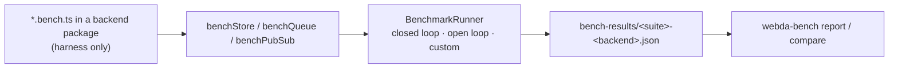

# @webda/bench

Benchmark framework for the Webda abstractions. One suite per abstraction, shared by every backend:

| Suite      | Function      | Abstraction     | Scenarios                                                                                                                                                        |
| ---------- | ------------- | --------------- | ---------------------------------------------------------------------------------------------------------------------------------------------------------------- |
| `store.*`  | `benchStore`  | `Store`         | get, exists, update, patch, setAttribute, incrementAttribute, upsert, queries (eq, range, IN, ORDER BY), create, delete, contention, paginate, iterate, bulk ops |
| `queue.*`  | `benchQueue`  | `Queue`         | send, raw drain, `consume()` per `maxConsumers` × `workerParallelism`, open-loop end-to-end latency, redelivery                                                  |
| `pubsub.*` | `benchPubSub` | `PubSubService` | publish, open-loop end-to-end latency, end-to-end throughput, fan-out, payload sizes                                                                             |

Stores are benchmarked through the `Repository` API, the path applications use.



## Run

```bash
pnpm run bench                                   # every package, sequentially (repository root)
pnpm --filter @webda/fs run bench                # one package
WEBDA_BENCH_PROFILE=full pnpm run bench          # smoke | quick (default) | full
WEBDA_BENCH_FILTER="store.get,queue.*" pnpm run bench
pnpm run bench:report                            # merge every bench-results folder into one table
```

Results are written to `<package>/bench-results/<suite>-<backend>.json` (`WEBDA_BENCH_OUTPUT` to change the folder).

| Profile | Use                      | Dataset | Concurrency | Ops per scenario |
| ------- | ------------------------ | ------- | ----------- | ---------------- |
| `smoke` | unit tests of the suites | 50      | 1, 4        | 20               |
| `quick` | pull requests (default)  | 1,000   | 1, 10       | 1,000            |
| `full`  | nightly / manual         | 10,000  | 1, 10, 50   | 10,000           |

## Add a backend

Benchmarks are regular vitest files named `*.bench.ts`, so they reuse the Webda test harness (`WebdaApplicationTest`,
`addService`). The package only provides a harness: how to create its service.

```ts
// packages/<backend>/src/<service>.bench.ts
import { suite, test } from "@webda/test";
import { WebdaApplicationTest } from "@webda/core/lib/test/application.js";
import { benchStore, useServiceType } from "@webda/bench";
import type { MyStore } from "./mystore.service.js";

@suite
class MyStoreBench extends WebdaApplicationTest {
  getTestConfiguration() {
    return { parameters: { ignoreBeans: true }, services: {} };
  }

  @test
  async store() {
    await benchStore({
      backend: "MyStore",
      // The class registered by the application: it has the configuration factory (defaults, unit conversions)
      createStore: (name, models) =>
        this.addService(useServiceType<MyStore>("Webda/MyStore"), { models /* connection... */ } as any, name),
      clean: store => store.__clean(), // optional, faster than deleting the documents one by one
      capabilities: { orderBy: true, bulk: true }, // optional, skip unsupported scenarios
      emulated: false // true for localstack / GCP emulators
    });
  }
}
```

Then in the package:

- `vitest.bench.config.ts`:
  ```ts
  import { defineConfig } from "vite";
  import { benchVitestOptions } from "@webda/bench/lib/vitest.js";
  export default defineConfig({ test: benchVitestOptions() });
  ```
- `package.json`: `"bench": "vitest run --config vitest.bench.config.ts"` and `"@webda/bench": "workspace:*"` in
  `devDependencies`
- `tsconfig.json`: add `"src/**/*.bench.ts"` to `exclude`, so bench files are not compiled into `lib`

Harness options:

| Harness              | Option              | Purpose                                                                       |
| -------------------- | ------------------- | ----------------------------------------------------------------------------- |
| `StoreBenchHarness`  | `clean`             | empty the store before/after the suite                                        |
|                      | `capabilities`      | `orderBy`, `bulk`, `atomic`: skip unsupported scenarios                       |
| `QueueBenchHarness`  | `purge`             | empty the queue between scenarios (defaults to `__clean`)                     |
|                      | `inconsistentSize`  | `size()` is approximate (SQS, GCP): size checks skipped                       |
|                      | `redeliveryDelayMs` | delay before an unacknowledged message is delivered again: enables redelivery |
| `PubSubBenchHarness` | `maxPayloadBytes`   | skip bigger payloads (e.g. 7900 for Postgres `NOTIFY`)                        |
|                      | `maxSubscribers`    | skip bigger fan-outs                                                          |
| all                  | `emulated`          | results come from an emulator: regression tracking only                       |

## Measurement

- **Closed loop**: N workers each waiting for its operation. Measures throughput.
- **Open loop**: operations start at a fixed rate whatever the previous ones did, latency is measured from the
  _scheduled_ start: a slow backend cannot hide its queueing delay (no coordinated omission). Used for end-to-end
  latency.
- **Custom**: the scenario measures itself (drains, fan-out deliveries).

Latencies are recorded in native histograms (`perf_hooks.createHistogram`); each result also holds CPU, memory, event
loop delay, the delta of the Webda metrics of the service under test, and correctness checks (lost / duplicated
messages, final counter of the contention scenario...). A result with more than 1% errors or a failed check is flagged
`unstable` and excluded from regression comparisons.

## Compare runs

```bash
webda-bench report <paths...> [--markdown file] [--summary] [--github-benchmark prefix]
webda-bench compare <baseline> <current> [--threshold 1.5] [--fail]
```

`--github-benchmark` writes the `customBiggerIsBetter` (throughput) and `customSmallerIsBetter` (p99) files of
[github-action-benchmark](https://github.com/benchmark-action/github-action-benchmark).
