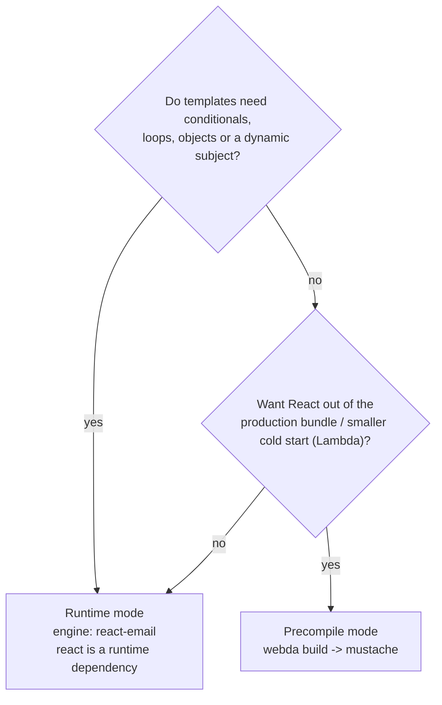

# @webda/react-email

[react-email](https://react.email) components as Webda templates, for the `TemplateService` of `@webda/templates` (and so for the `Mailer`).

Write an email as a React component, then either render it on every send (runtime mode) or precompile it to mustache templates at build time (precompile mode).

`react`, `react-dom` and `@react-email/render` are peer dependencies: install them next to the package. `@webda/core` and `@webda/templates` do not depend on React.

## Template convention

```tsx
// emails/event-confirmation/email.tsx  (or emails/event-confirmation.tsx)
import { Html, Text } from "@react-email/components";

export default function EventConfirmation({ firstName, eventName, locale }: Props) {
  return (
    <Html lang={locale}>
      <Text>
        Hi {firstName}, you are registered to {eventName}
      </Text>
    </Html>
  );
}

// Used by the preview and by the precompile mode
EventConfirmation.PreviewProps = { firstName: "Marie", eventName: "French Playdate" } satisfies Props;
// A string, or a function of the data (runtime mode only)
EventConfirmation.Subject = "You're registered! See you at the event";
// Optional: otherwise the text part is the html converted with toPlainText
EventConfirmation.Text = (props: Props) => `Hi ${props.firstName}`;
```

- `renderAll("event-confirmation", data)` returns `{ subject, html, text }`, and `render("event-confirmation/html")` renders one part.
- Locales follow the `TemplateService` lookup: `emails/event-confirmation/fr-FR/email.tsx` or `emails/event-confirmation.fr-FR.tsx`. The `locale` is also passed to the component as a prop, so one component can translate itself.
- The template data are the component props. The `Mailer` adds `now`.

## Choosing a mode



## Runtime mode

The `react-email` engine is registered when the package is loaded. Point the `TemplateService` at the emails folder:

```jsonc
{
  "services": {
    "TemplateService": {
      "type": "Webda/TemplateService",
      "folders": ["./emails"],
      "engine": "react-email",
      "engines": {
        "react-email": {
          // Import the compiled lib/emails/**/*.js when it exists, the .tsx source otherwise
          "sourceMap": { "emails/": "lib/emails/" }
        }
      }
    }
  }
}
```

Conditionals, `.map()` over arrays, objects and a `Subject(props)` function all work, as the component renders with the real data.

Engine options: `sourceMap`, `extensions` (add `js` when `folders` points at `lib/emails` and the sources are not deployed), `pretty` (default `false`) and `fixApostrophes` (default `true`, replaces `&#x27;` by `'`, which Yahoo shows literally).

`renderString` is not supported with this engine: a component cannot be compiled from a string.

### Production notes

- Compile `emails/` with `"jsx": "react-jsx"` in your `tsconfig.json` (`webdac build` writes it to `lib/emails`), or deploy the sources and run under a `tsx` loader. Without `sourceMap` the `.tsx` source is imported.
- The templates are cached by the `TemplateService`; `cache: false` and debug mode reload them. Only the entry module reloads on change: a layout imported by the email is not re-read until the process restarts.

## Precompile mode

Generates `<output>/<name>/{html,text,subject}.mustache` from each email, so production does not load React:

```jsonc
{
  "services": {
    "reactEmail": {
      "type": "Webda/ReactEmailService",
      "source": "./emails",
      "output": "./templates/emails"
    },
    "Mailer": { "templates": "./templates/emails" }
  }
}
```

`webda build` runs it through the build hook, or run it on demand:

```bash
webda react-email build --source ./emails --output ./templates/emails
```

Parameters: `source` (default `./emails`), `output` (default `./templates`), `pretty` (default `true`), `fixApostrophes` (default `true`) and `sourceMap`. Both return a non-zero exit code when a template fails.

Each string or number key of `PreviewProps` becomes a `{{{key}}}` placeholder before rendering, so the variables are flat. A template whose `PreviewProps` holds another kind of value (array, object, boolean) is skipped with a `WARN`: use the runtime mode for it.

## Preview

The convention matches react-email's, so its CLI works as-is:

```bash
email dev --dir emails
```

## Migrating from a custom script (littlefrenchies)

1. Delete `backend/scripts/email-renderer.ts`, the bazel `email-renderer` and `static-emails` targets and the `email:build` script.
2. Either add the `ReactEmailService` (precompile mode, the generated `templates/emails` folder is unchanged), or set `TemplateService.folders` to `["./emails"]` with the `react-email` engine and drop the generated `templates/emails` (runtime mode).
