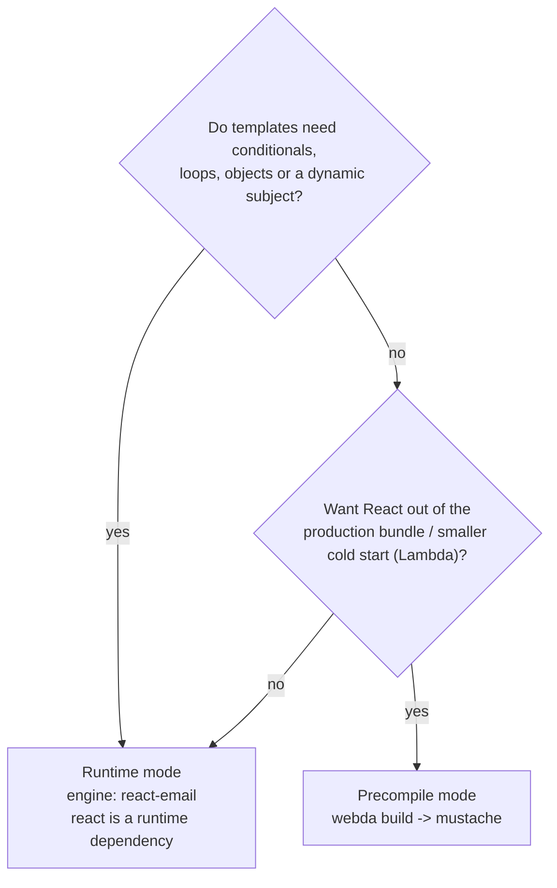

# @webda/react-email

[react-email](https://react.email) components as Webda templates, for the `TemplateService` of `@webda/templates` (and so for the `Mailer`).

Write an email as a React component, then either render it on every send (runtime mode) or precompile it to mustache templates at build time (precompile mode).

`react`, `react-dom` and `@react-email/render` are peer dependencies: install them next to the package. `tsx` is an optional peer dependency, used to import `.tsx` sources under plain node (see [Loading the sources](#loading-the-sources)). `@webda/core` and `@webda/templates` do not depend on React.

The `Webda/ReactEmailService` modda and the `react-email` engine do not load React when they are imported: React is imported on the first render. Importing the package barrel (`import { renderEmail } from "@webda/react-email"`) does load React.

## Template convention

```tsx
// emails/event-confirmation/email.tsx  (or emails/event-confirmation.tsx)
import { Html, Text } from "@react-email/components";

export default function EventConfirmation({ firstName, eventName, locale }: Props) {
  return (
    <Html lang={locale}>
      <Text>
        Hi {firstName}, you are registered to {eventName}
      </Text>
    </Html>
  );
}

// Used by the preview and by the precompile mode
EventConfirmation.PreviewProps = { firstName: "Marie", eventName: "French Playdate" } satisfies Props;
// A string, or a function of the data (runtime mode only)
EventConfirmation.Subject = "You're registered! See you at the event";
// Optional: otherwise the text part is the html converted with toPlainText
EventConfirmation.Text = (props: Props) => `Hi ${props.firstName}`;
```

- `renderAll("event-confirmation", data)` returns `{ subject, html, text }`, and `render("event-confirmation/html")` renders one part.
- Locales follow the `TemplateService` lookup: `emails/event-confirmation/fr-FR/email.tsx` or `emails/event-confirmation.fr-FR.tsx`. The `locale` is also passed to the component as a prop, so one component can translate itself.
- The template data are the component props. The `Mailer` adds `now`.
- A component throwing while rendering fails the render (`renderAll` rejects, the precompile reports it as failed), instead of React's silent fallback to an empty client-rendered email.
- Shared components (layouts, buttons) live next to the emails: name them with a `_` prefix (`emails/_layouts.tsx`) to keep them out of `TemplateService.list()`. A module without a default export component is never a template, but only the `_` prefix hides it from `list()`.

## Choosing a mode



## Runtime mode

The `react-email` engine is registered when the package is loaded. Point the `TemplateService` at the emails folder. A standard webda project compiles only `src/`, so keep the emails in `src/emails/`:

```jsonc
{
  "services": {
    "TemplateService": {
      "type": "Webda/TemplateService",
      "folders": ["./src/emails"],
      "engine": "react-email",
      "engines": {
        "react-email": {
          // Import the compiled lib/emails/**/*.js when it exists, the .tsx source otherwise
          "sourceMap": { "src/emails/": "lib/emails/" }
        }
      }
    }
  }
}
```

Conditionals, `.map()` over arrays, objects and a `Subject(props)` function all work, as the component renders with the real data.

Engine options: `sourceMap`, `extensions` (add `js` when `folders` points at `lib/emails` and the sources are not deployed), `pretty` (default `false`) and `fixApostrophes` (default `true`, replaces `&#x27;` by `'`, which Yahoo shows literally).

The engine configuration is process-wide: there is one `react-email` engine, so the last `TemplateService` configuring `engines["react-email"]` wins for every `TemplateService`, and adding `js` to `extensions` makes `.js` a template extension for every renderer of the process.

`renderString` is not supported with this engine: a component cannot be compiled from a string.

### Loading the sources

An email module is imported, in order:

1. The compiled `.js` file the `sourceMap` points at, when it exists. Compile with `"jsx": "react-jsx"` in your `tsconfig.json`: `webda build` (which `webdac build` dispatches to) writes `src/emails` to `lib/emails`.
2. The `.tsx`/`.jsx` source itself. It works under a TypeScript loader (vitest, `node --import tsx`), but the `webda` launcher runs plain node, which cannot import it.
3. Under plain node, the source through [`tsx`](https://tsx.is) when it is installed (`pnpm add tsx`). This is the way for an `emails/` folder at the project root, outside the compiled `src/`, as in littlefrenchies. tsx compiles the JSX with the classic runtime unless your `tsconfig.json` covers the emails with `"jsx": "react-jsx"`, so `React` is made global, as the react-email scripts do.

Without `sourceMap` nor `tsx`, a `.tsx` email fails under plain node with an error explaining both options.

### Production notes

- The templates are cached by the `TemplateService`; `cache: false` and debug mode reload them. Only the entry module reloads on change: a layout imported by the email is not re-read until the process restarts.
- Each render is memoized per component, data object and locale, so `renderAll` renders once. A `JSON.stringify` fingerprint of the data detects a mutated object between two sends; mutations it cannot see (inside a `Map`, a `Set` or a function) are not detected, so pass a new data object rather than mutating one.

## Precompile mode

Generates `<output>/<name>/{html,text,subject}.mustache` from each email, so production does not load React:

```jsonc
{
  "services": {
    "reactEmail": {
      "type": "Webda/ReactEmailService",
      "source": "./emails",
      "output": "./templates/emails"
    },
    "Mailer": { "templates": "./templates/emails" }
  }
}
```

`webda build` (which `webdac build` dispatches to) runs it through the build hook, or run it on demand:

```bash
webda react-email build --source ./emails --output ./templates/emails
```

Parameters: `source` (default `./emails`), `output` (default `./templates`), `pretty` (default `true`), `fixApostrophes` (default `true`) and `sourceMap`; the command takes `--source`, `--output`, `--pretty` and `--fixApostrophes` (`--no-fixApostrophes` keeps `&#x27;`). Both return a non-zero exit code when a template fails. Under plain node the `.tsx` sources need `tsx` installed, or a `sourceMap` to their compiled files (see [Loading the sources](#loading-the-sources)).

Each string or number key of `PreviewProps` becomes a `{{{key}}}` placeholder before rendering, so the variables are flat. A template whose `PreviewProps` holds another kind of value (array, object, boolean) is skipped with a `WARN`: use the runtime mode for it.

A locale variant (`emails/event-confirmation/fr-FR/email.tsx` or `emails/event-confirmation.fr-FR.tsx`) also receives its `locale` prop, as in runtime mode.

## Preview

The convention matches react-email's, so its CLI works as-is:

```bash
email dev --dir emails
```

## Migrating from a custom script (littlefrenchies)

1. Delete `backend/scripts/email-renderer.ts`, the bazel `email-renderer` and `static-emails` targets and the `email:build` script.
2. Either add the `ReactEmailService` (precompile mode, the generated `templates/emails` folder is unchanged), or set `TemplateService.folders` to `["./emails"]` with the `react-email` engine and drop the generated `templates/emails` (runtime mode).
3. Add `tsx` to the dependencies: `emails/` sits outside the compiled `src/`, so the `webda` launcher imports the `.tsx` sources through it. The script's `globalThis.React = React` is no longer needed.
4. Rename `emails/layouts.tsx` to `emails/_layouts.tsx` (and its imports) so the runtime `TemplateService.list()` does not report it as a template.
